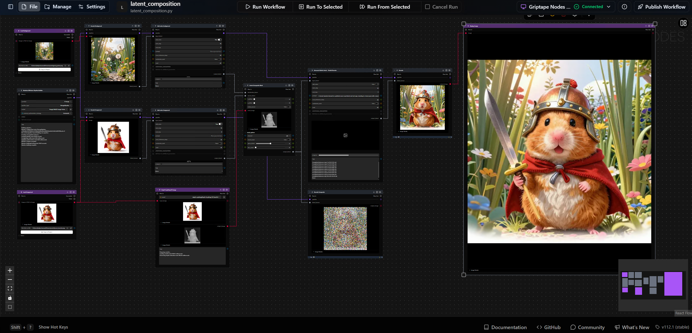

# Griptape Nodes Diffusion Library
Build flexible media generation workflows with 🧨 Diffusers pipelines in [Griptape Nodes](https://github.com/griptape-ai/griptape-nodes).

The Diffusion Library is a node library for creators who want more control over diffusion execution. Instead of running a fixed, monolithic "generate image" step, you break the diffusion process into individual, connectable stages — so you can inspect, reuse, and customize each part of the pipeline.

### [How it works](#how-it-works) | [Quick start](#quick-start) | [Supported models](#supported-models) | [Workflows](#workflow-templates-included) | [Docs](docs/index.md) | [Support](#support)




## How it works

A typical flow looks like this:

1. **Build a pipeline** with the [Build Pipeline](docs/nodes/pipeline_builder.md) node, then reuse its output across generations.
1. **Prepare your starting latents** by creating noise or an empty latent, or by encoding an image or video.
1. **Run diffusion** to produce new latents — optionally multiple times for multi-stage or rediffusion workflows.
1. **Transform latents** with math, masked compositing, or upsampling between stages.
1. **Decode** the final latents back into images or video with the VAE.

Because every stage is a node, you can branch, chain, and reorder steps — enabling patterns like multi-stage refinement, ControlNet stacking, latent composition, first/last-frame video conditioning, and latent upscaling that aren't possible with a single end-to-end generate node.

## Quick start

The easiest way to install this library is through the Griptape Nodes UI:

1. In Griptape Nodes, open **Manage → Library Management**.
1. Click **Add Library** and paste:
    ```text
    https://github.com/griptape-ai/griptape-nodes-library-diffusers
    ```
    To pin a version, open **Advanced Options** and set **Branch / Tag / Commit** (default `main`). You can also change the **Download Directory** there.
1. Click **Install**, review the library details, and confirm.
1. The library registers automatically and its nodes appear in the node picker. If they don't show up, click **Refresh Libraries** in Library Management.

### Your first generation

The quickest way to see the pieces working together is the **Text2Image** workflow template:

1. Click the **Text2Image** template to open it (see [Workflow templates included](#workflow-templates-included)).
1. Click **Open Model Manager to download** to download the model. Weights are stored in your Hugging Face cache (see the note under [Supported models](#supported-models)).
1. Run the entire workflow.
1. Change the prompt or the model and run it again. If you change only the prompt, the loaded pipeline is reused, so the run is much faster.

To go further, open the other templates, which add LoRA, ControlNet, inpainting, multi-stage refinement and video.

### Hugging Face token (gated models)

Some models (e.g. FLUX.1 [dev]/[schnell]) are gated on Hugging Face. To use them:

1. Accept the model's terms on its Hugging Face page.
1. Create a **Read** token at https://huggingface.co/settings/tokens.
1. Add it as `HF_TOKEN` under **Settings → API Keys & Secrets**.

### Manual configuration

Clone the repo and register it in `griptape_nodes_config.json`:

```json
{
  "app_events": {
    "on_app_initialization_complete": {
      "libraries_to_register": [
        "path/to/griptape-nodes-library-diffusers/griptape-nodes-library.json"
      ]
    }
  }
}
```

## Supported models

Choose a provider from the Build Pipeline node's `provider` dropdown. Supported models include the ones below. Capabilities not listed are not claimed.

| Model | Variants | Capabilities |
| --- | --- | --- |
| **Flux 1** | dev, schnell, Krea | Text-to-image<br>Image-to-image, Inpainting (native)<br>ControlNet, Masked denoising, LoRA |
| **Flux Fill** | Fill checkpoint | Inpainting (native, only mode)<br>LoRA |
| **Flux Kontext** | Kontext | Image editing (native)<br>Inpainting (native, with reference image)<br>Masked denoising, LoRA |
| **Flux2** | dev, including 4-bit (bitsandbytes) | Text-to-image<br>Image-to-image<br>Masked denoising, LoRA |
| **Flux2 Klein** | 4B and 9B, base and distilled; fp8 and nvfp4 quantized | Image editing (native)<br>Image-to-image, Inpainting (native, with reference images), Text-to-image<br>Masked denoising, LoRA |
| **FLUX.3 Image Klein** | Base and distilled; optional prompt upsampler | Image editing (native, layout editing needs prompt upsampler)<br>Image-to-image, Text-to-image<br>Masked denoising, LoRA |
| **HunyuanVideo 1.5** | 480p and 720p; distilled; text-to-video and image-to-video checkpoints | Text-to-video<br>Image-to-video (first frame only)<br>LoRA |
| **LTX** | LTX-Video 0.9.x, including 0.9.7 and 0.9.8 distilled | Video-to-video (native)<br>Image-to-video, Text-to-video<br>Image/video references at frame positions, LoRA |
| **LTX-2** | LTX-2, 2.3 and 2.5, including distilled | HDR IC-LoRA, IC-LoRA, Joint video-and-audio generation (video-only with HDR IC-LoRA)<br>Image-to-video, Text-to-video, Video-to-video (native)<br>Image/video references at frame positions, LoRA |
| **MiniMax-H3** | MiniMax-H3 | Joint soundtrack generation<br>First/last image-keyframe conditioning (FL2VA), Text-to-video<br>LoRA |
| **Qwen-Image** | Base | Text-to-image<br>Image-to-image, Inpainting (native)<br>ControlNet, Masked denoising, LoRA |
| **Qwen-Image-Edit** | Base, 2509, 2511 | Image editing (native, multi-image editing)<br>Inpainting<br>Masked denoising, LoRA |
| **Stable Diffusion 3 / 3.5** | SD3 Medium; SD3.5 Medium, Large and Large Turbo | Text-to-image<br>Image-to-image (native), Inpainting (native)<br>ControlNet, Masked denoising, LoRA |
| **Stable Diffusion XL** | Base, refiner, inpainting | Text-to-image<br>Image-to-image (native), Inpainting (native)<br>ControlNet, Masked denoising, LoRA |
| **WAN 2.x** | WAN 2.1 (T2V 1.3B and 14B, I2V 14B 480p and 720p); WAN 2.2 (T2V and I2V A14B) | Text-to-video<br>Image-to-video (first frame required, optional last frame)<br>LoRA |
| **WAN Animate** | WAN 2.2 Animate | Character animation (character image with pose/face videos)<br>Replace mode (background video and mask video)<br>LoRA |
| **WAN Animate 2** | Animate 2 and Animate 2 distilled | Character animation (character image with driving video; segmented longer clips)<br>LoRA |
| **WAN VACE** | WAN 2.1 VACE (1.3B and 14B) | Video inpainting/outpainting (per-frame masks)<br>Image/video source conditioning<br>Up to eight reference images, LoRA |
| **Z-Image** | Turbo | Text-to-image<br>Image-to-image, Inpainting (native)<br>ControlNet (one ControlNet only), Masked denoising, LoRA |


Models are loaded from Hugging Face repositories in Diffusers format (single-file `.safetensors` checkpoints are not loaded directly — use a Hugging Face repo ID). To fuse LoRAs into the model weights, connect their outputs to the Build Pipeline node.

> **Note:** All models are downloaded locally to the Hugging Face cache the first time they're used (default: `~/.cache/huggingface/hub` on Linux/macOS, `%USERPROFILE%\.cache\huggingface\hub` on Windows). To store them elsewhere, set the `HF_HOME` environment variable globally before launching the engine — e.g. `HF_HOME=D:\models\hf` on Windows or `export HF_HOME=/mnt/models/hf` on Linux/macOS.

## Controls

Prompts, guidance, and other generation knobs are exposed as parameters on the generation and conditioning nodes — they vary per model, since each pipeline supports different inputs. Shared runtime controls include `num_inference_steps`, `seed` and step-range controls for multi-stage workflows. ControlNet and LoRA nodes expose their own influence/weight parameters. See the [docs](docs/index.md) for per-node details.

## Live previews

Enable live image previews to stream intermediate decoded images during generation. Useful for monitoring long runs, at the cost of inference speed.

To turn it on:

1. Open **Settings → Library Settings** in the Griptape Nodes UI.
1. Scroll to the **Diffusion Library** section.
1. Toggle **Enable Image Preview Intermediates** on.


## Performance and memory

The Build Pipeline node caches the loaded pipeline and reuses it across runs, rebuilding only when its configuration changes.

For lower-VRAM setups, the Build Pipeline node provides a **Memory Optimization Strategy** selector:

- **Automatic** — Griptape picks reasonable defaults for the chosen model.
- **Manual** — you control each knob individually:
    - **Quantization mode**: `fp8`, `int8`, or `int4` (via `optimum-quanto` / `bitsandbytes`) — shrinks transformer weights at the cost of some quality.
    - **CPU offload strategy**: `Model` (whole submodules) or `Sequential` (per-layer) — moves weights to CPU when idle to free VRAM, at the cost of inference speed.
    - **Attention slicing** — runs attention in smaller chunks; cheap memory win, small speed hit.
    - **VAE slicing** — decodes the latent in batches of 1; helps with large batch sizes.
    - **Transformer layerwise casting** — keeps the transformer in a lower precision and upcasts per layer during compute.

Enable only what you need — each option trades some speed for memory. Each parameter on the Build Pipeline node has a help badge with more detail.

> ## ⚠️ Using alongside the Advanced Media Library
> The Diffusion Library and the Advanced Media Library's fixed diffusion pipelines each maintain their own in-memory pipeline cache. If both libraries are loaded and used in the same session, you may end up holding two full copies of overlapping model weights in VRAM/RAM at once, leading to significantly higher memory usage and out-of-memory errors. Prefer using one library per session, or reduce memory pressure via the optimization knobs above.

## Workflow templates included

- **Text2Image** — The simplest starting point. Type a description and get an image back.
- **MultistageText2Image** — Makes an image in several passes: a first rough draft, then one or more rounds that polish the details.
- **LoRAText2Image** — Text-to-image with a LoRA, a small add-on file that gives the model a specific style, character, or subject.
- **ControlnetText2Image** — Text-to-image where a guide image (such as edges, depth, or a pose) controls the layout of the result.
- **ControlnetInpainting** — Repaints a masked area of an image while a guide image keeps the new content in the right shape.
- **CustomPipelineText2Image** — Shows how to swap in your own model parts (such as the text encoder or VAE) instead of the defaults. Aimed at more advanced users.
- **Image2Image** — Starts from your own picture and reworks it to match a prompt. Great for restyling or variations.
- **Inpainting** — Paint a mask over part of an image and describe what should appear there. Everything outside the mask stays the same.
- **Flux2KleinGuidedInpainting** — Inpainting with Flux2 Klein, where you steer what fills the masked area with a reference image.
- **FluxKontextImageEdit** — Edit a picture by telling the model what to change, for example "make it sunset" or "add a hat".
- **FluxKontextInpainting** — Edit only the masked part of a picture with plain-language instructions, using Flux Kontext.
- **Flux3LayoutControlText2Image** — Control where things go in a generated image by giving the model a list of elements and their positions.
- **Flux3LayoutControlImageBasedEditing** — Edit an existing image by listing the elements you want changed and where they sit.
- **LatentCompositionWithMaskedDenoising** — Pastes a subject into a new scene, then blends it in two ways so you can compare which looks more natural.
- **FirstAndLastFrameImage2Video** — Give it a starting image and an ending image, and it creates the video that moves between them.
- **LTX23-IC-LoRA** — Creates a video from text that follows the structure or motion of a reference clip.
- **LTX23-HDR-Text2Video-Upsample-Two-Stage** — Creates an HDR video (wider range of brightness and color) from text, then enlarges it for a sharper result.
- **Multi-ViewPromptBatcher** — Runs a list of prompts against one reference image to produce many different angles of the same subject in one go.
- **SuccessFailure** — A small utility example showing how to take a different path in a flow if a step fails. Useful for error handling.
- **VideoInpaintingAndOutpaintingWANVace** — Fills in a masked part of a video (inpainting) or extends the video beyond its original edges (outpainting).
- **WanAnimate** — Brings a character photo to life using a pose video for the body movement and a face video for the expressions.
- **WanAnimate2** — Animates a character photo by copying the movement from a pose video. You describe the character, so no face video is needed.
- **WanReplace** — Swaps the person in a video for a character from your reference image, keeping the original background and movement.

## Requirements

This library has been tested on Windows and Linux. macOS testing is limited; some kernels may not be supported on **MPS**. See [griptape-nodes-library.json](griptape-nodes-library.json) for the full dependency list.

**Griptape Nodes engine 0.97.0 or newer.** The model pickers on this library's nodes check your license before offering a model, and that enforcement lives in the engine. On an older engine the library declares a version it cannot satisfy, so the engine marks it **unusable** and it will not load — update the engine rather than editing the declared version, since a lower floor would let the library offer models your license does not permit.

### Model licensing

Some models this library exposes are gated by license. Where that applies:

- Models you are not permitted to use still appear in the picker, marked with a shield icon and *"Not permitted by your license"*.
- Selecting one badges the parameter **Model Not Permitted**; running the node then fails with the reason rather than downloading weights.
- If a picker reports that models could not be checked against your license, that is a library registration fault, not a licensing one — please [open an issue](https://github.com/griptape-ai/griptape-nodes-library-diffusers/issues).

Which models are gated depends on your license, so the picker is the source of truth rather than this page.

## Support

Found a bug or have a feature request? Please [open an issue](https://github.com/griptape-ai/griptape-nodes-library-diffusers/issues).

## Contributing

See [CONTRIBUTING.md](CONTRIBUTING.md) for development setup and contribution guidelines.
