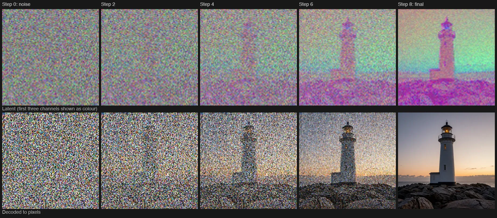

A latent is the compressed form of a picture or clip that a diffusion model works on. It is a block of numbers that stands for the image. You can't look at it. It has to be turned back into pixels first. The words "latent", "noise" and "decode" appear in many node names. This page explains what they mean.

## The idea

A diffusion model does not paint pixels directly. It works on the latent, which is its own working format. Working on this smaller form is why the model can run on a normal GPU, and it is why the library splits the job into separate nodes.

Making an image takes three moves:

1. **Start with a latent.** For a new image this is random noise, like static on a screen. For an existing picture or clip, it is that picture encoded into a latent.
1. **Clean it up step by step.** The model changes the latent in a series of steps, guided by your prompt, removing noise a little at a time until what is left matches the prompt. This is called denoising.
1. **Decode it.** The result is still a latent. Decoding turns it back into pixels you can view and save.

## What it looks like

This run used Z-Image Turbo at 768 x 768 with 8 steps and seed 42. A step is one round of clean-up. The prompt was "a lighthouse on a rocky coast at sunset, cinematic, detailed". After each step, the latent was decoded so you can see what the model has so far.


The top row of the filmstrip shows the latent itself, with three of its channels drawn as colour. The bottom row shows the same latent decoded to pixels.



Step 0 is pure noise. The large shapes appear first, the lighthouse and the horizon by step 4, and the fine detail and clean colour arrive in the last steps. In a workflow, Decode Media decodes only the final latent. The in-between pictures here are for illustration.

## The pattern in nodes

```text
Build Pipeline → Create Noise Latent → Generate Latent → Decode Media
   (the model)     (start)              (denoise)         (pixels)
```

- [Build Pipeline](../nodes/LatentDiffusionPipelineBuilderNode.md) loads the model.
- [Create Noise Latent](../nodes/NoiseLatentNode.md) makes the starting latent. The seed is a number that sets which noise you get, so the same seed, size and model give the same start.
- [Generate Latent](../nodes/DiffusionPipelineGenerateLatentNode.md) runs the denoising steps with your prompt, the text description of what you want.
- [Decode Media](../nodes/VaeDecodeNode.md) turns the final latent into an image or video.

To start from your own picture or clip instead of noise, put [Encode Media](../nodes/VaeEncodeNode.md) in place of Create Noise Latent. Turn `add_noise` on in Generate Latent so the model has something to rework.

## Why this is useful

Because the latent is a separate step you can see and change, you can:

- Run Generate Latent more than once, feeding one result into the next, to refine an image.
- Paste one image into another before decoding with [Composite Latents with Mask](../nodes/LatentCompositeMaskNode.md), or combine latents with the add, subtract and multiply nodes.
- Enlarge a video latent to twice the width and height with [Upsample Latent](../nodes/LatentUpsamplerNode.md) before you decode it.
- Save a latent with [Save Latent Tensor](../nodes/SaveLatentTensorNode.md) to inspect it or reuse it later.

## Things to know

- A latent is shaped for one model. Create it from the pipeline you will run it through, and do not move a latent between different models.
- A latent has no preview. To see what one holds, decode it.
- Encoding and decoding go through the model's VAE, a small companion model that translates between pixels and latents. See [What is a VAE?](what-is-a-vae.md). An image that is encoded and decoded again can come back slightly different from the original.
