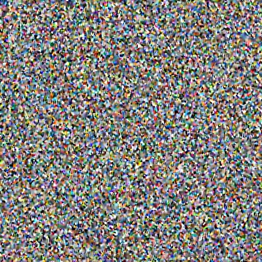

A latent is the compressed form of a picture or clip that a diffusion model works on. It is a block of numbers that stands for the image. It is not a picture, so it has to be turned back into pixels before you can view it.

## The idea

A diffusion model does not paint pixels directly. It works on the latent, which is its own working format. The latent is far smaller than a full frame, so the model needs far less graphics card (GPU) memory than it would to work on pixels.

The library also gives each stage its own node: make the starting latent, denoise it, decode it. That lets you step in between the stages.

Making an image takes three moves:

1. **Start with a latent.** For a new image this is random noise, like static on a screen. The noise is random numbers, and a number called the seed fixes which ones you get. The same seed gives the same noise. For an existing picture or clip, the picture is encoded into a latent first. The model can only start from noise, so a controlled amount of noise is mixed into your picture. The more noise, the more the model is free to change. See [When noise is added](#when-noise-is-added).
1. **Clean it up step by step.** The model changes the latent in a series of steps, each one a round of clean-up. It is guided by your text description (the prompt) and removes noise a little at a time until what is left matches it. This is called denoising.
1. **Decode it.** The result is still a latent. Decoding turns it back into pixels you can view and save.

## What it looks like

This run used Z-Image Turbo at 768 x 768 with 8 steps and seed 42. The demo used 8 steps to keep the animation short. The Text2Image workflow uses 20 steps on the same model. The prompt was "a lighthouse on a rocky coast at sunset, cinematic, detailed". The animation shows the decoded latent after each step, so you can see what the model has so far.



A latent has many layers, called channels, and they are unrelated to the red, green, blue and alpha channels of an image. The filmstrip shows steps 0, 2, 4, 6 and 8. The top row is the latent drawn as colour, using 3 of its many channels as red, green and blue. That gives a rough view. The bottom row is the same latent decoded to pixels.


Step 0 is pure noise. The large shapes appear first. By step 4 the lighthouse and the horizon are visible. Fine detail and clean colour arrive in the last steps. In a workflow, Decode Media decodes only the final latent. The in-between pictures here are for illustration.

## The pattern in nodes

```text
Build Pipeline → Create Noise Latent → Generate Latent → Decode Media
   (the model)     (start)              (denoise)         (pixels)
```

- [Build Pipeline](../nodes/LatentDiffusionPipelineBuilderNode.md) loads the model.
- [Create Noise Latent](../nodes/NoiseLatentNode.md) makes the starting latent. The seed sets which noise you get, so the same seed, size and model give the same start.
- [Generate Latent](../nodes/DiffusionPipelineGenerateLatentNode.md) runs the denoising steps with your prompt.
- [Decode Media](../nodes/VaeDecodeNode.md) turns the final latent into an image or video.

To start from your own picture or clip instead of noise, put [Encode Media](../nodes/VaeEncodeNode.md) in place of Create Noise Latent. Turn `add_noise` on in Generate Latent. `add_noise` mixes noise into your picture, and how much depends on `start_step`. See [When noise is added](#when-noise-is-added).

## When noise is added

The `add_noise` setting on [Generate Latent](../nodes/DiffusionPipelineGenerateLatentNode.md) is off by default. When it is on, noise is mixed into the input latent before denoising. `start_step` is the step the run begins from. Skipping the early steps means less noise is added, so more of your input survives. A `start_step` of 0 treats the input as fully noisy. When `add_noise` is off, denoising starts from the input exactly as it is.

Set it by what you connect to Generate Latent:

- [Create Noise Latent](../nodes/NoiseLatentNode.md): leave it off. The input is already noise.
- [Create Empty Latent](../nodes/EmptyLatentNode.md): turn it on. A blank latent is not noise, so noise must be added before denoising.
- [Encode Media](../nodes/VaeEncodeNode.md), or the output of an earlier Generate Latent: turn it on. This is image-to-image and refinement.
- [Set Latent Mask](../nodes/SetLatentMaskNode.md), a node that attaches a mask to a latent for masked denoising: turn it on. With it off, denoising starts from the clean source image.
- [Encode Masked Media](../nodes/VaeMaskEncodeNode.md), for inpainting: Encode Masked Media prepares the noise itself, so Generate Latent hides its Add Noise switch.

## Why this is useful

Because the latent is a separate stage you can step into, you can:

- Run Generate Latent more than once, feeding one result into the next, to refine an image.
- Paste one image into another before decoding with [Composite Latents with Mask](../nodes/LatentCompositeMaskNode.md), or combine latents with the add, subtract and multiply nodes.
- Enlarge a video latent to twice the width and height with [Upsample Latent](../nodes/LatentUpsamplerNode.md) before you decode it.
- Save a latent with [Save Latent](../nodes/SaveLatentTensorNode.md) to inspect it or reuse it later.

## Things to know

- A latent is shaped for one model. Create it from the pipeline you will run it through, and do not move a latent between different models.
- A latent has no real preview. To see what one holds, decode it.
- Encoding and decoding go through the model's VAE, a small companion model that translates between pixels and latents. See [What is a VAE?](what-is-a-vae.md). An image that is encoded and decoded again can come back slightly different from the original.
