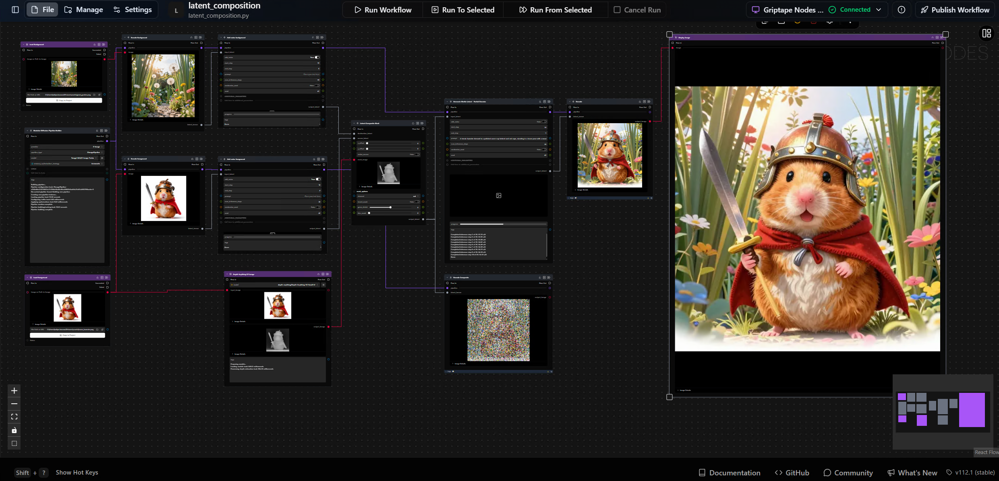

The Diffusion Library makes images and video from a text description or from a picture you supply. It uses diffusion models, which start from random noise and refine it step by step into a picture or clip that matches your prompt. Instead of one "generate" node, each stage is its own node: load a model, make or encode a starting point, run the diffusion, adjust the result, and decode it into a picture or a clip. You can see, reuse and change every stage.

Because the stages are separate, you can do things a single node can't. You can refine an image over several passes, stack [ControlNets](nodes/ControlNetNode.md) (extra guides that steer the layout), paste one image into another before it is turned back into pixels, condition a video on its first and last frames, or enlarge a result before decoding it. The model is loaded once and reused across runs, so changing only a prompt is fast.

Download each model in Model Manager before you run a workflow. Build Pipeline shows an **Open Model Manager to Download** button when the selected model is missing. The models come from Hugging Face, a site that hosts shared models. Some, such as FLUX.1 dev, are gated and need an `HF_TOKEN` access token in your API keys. See [Hugging Face and Diffusers](guides/hugging-face-and-diffusers.md).

## Where to start

- **Learn the idea.** [What is a latent?](guides/what-is-a-latent.md) explains the start, clean-up and decode pattern behind every workflow, and the working format the model uses in between.
- **Learn what a VAE is.** [What is a VAE?](guides/what-is-a-vae.md) explains the encoder and decoder that move pictures into latents and back.
- **Learn the other parts.** [What are a text encoder and a tokenizer?](guides/what-is-a-text-encoder.md), [What are a transformer and a UNet?](guides/what-is-a-transformer.md) and [What is a scheduler?](guides/what-is-a-scheduler.md) explain the parts you can swap with Load Component and Load Scheduler.
- **Make your first image.** Open [Text2Image](workflows/Text2Image.md). It already has a prompt, a size and a model set.
- **Rework a picture you already have.** [Image2Image](workflows/Image2Image.md) repaints your image to match a prompt.
- **Change one part of an image.** [Inpainting](workflows/Inpainting.md) repaints only the area you mask.
- **Make a video between two images.** [FirstAndLastFrameImage2Video](workflows/FirstAndLastFrameImage2Video.md) fills in the motion from a first frame to a last frame.
- **Understand the pieces.** [Build Pipeline](nodes/LatentDiffusionPipelineBuilderNode.md) loads the model. [Generate Latent](nodes/DiffusionPipelineGenerateLatentNode.md) runs the diffusion. [Decode Media](nodes/VaeDecodeNode.md) turns the result into an image or video.
- **Guide the layout.** [Load ControlNet](nodes/ControlNetNode.md) and [Apply ControlNet](nodes/ControlNetDiffusionPipelineBuilderNode.md) steer a result with edges, depth or a pose.
- **Add a style or subject.** [Load LoRA](nodes/LoadLora.md) adds a LoRA, a small add-on file that gives the model a particular style or subject.
- **Check memory.** [Estimate Pipeline Memory](nodes/PipelineMemoryEstimateNode.md) shows how much GPU memory a run needs. The [command-line version](tools/estimate_workflow_memory.md) does the same for a saved workflow.

## Node categories

The editor groups the nodes under Diffusion.

| Category | What it holds |
| --- | --- |
| Pipeline | Loading models, ControlNets, LoRAs, components and schedulers, and clearing or estimating the loaded pipeline. |
| Create | Starting points: random noise or an empty latent (the model's working format). |
| Processing | Running the diffusion and enlarging a latent. |
| Transform | Adding, subtracting, multiplying and compositing latents, and setting a latent mask. |
| Conditioning | Reference images and video that guide a generation. |
| Encode & Decode | Moving between images or video and latents. |
| IO | Saving latents and EXR sequences. |

Models that this library supports include Flux, Qwen-Image, Stable Diffusion, Z-Image, LTX, WAN and HunyuanVideo. Models your license does not permit are marked in the model picker.
