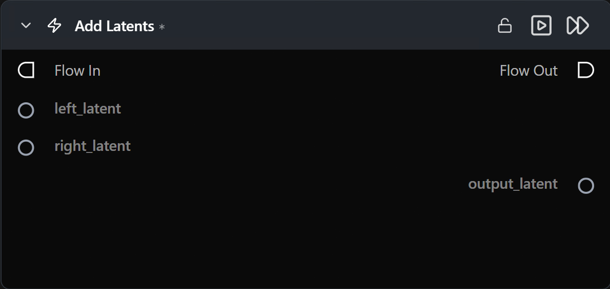

## When to use it

You have two latents and want their sum as a new latent. Common cases are blending two results or adding noise to a latent.

Both latents must be connected and must be the same size. Latents from different model families, such as Flux and SDXL, normally differ in size. If the sizes happen to match, the sum is still meaningless.

## Where it fits

```text
Generate Latent (A) ─┐
                     ├─→ [Add Latents] → Generate Latent / Convert Latent to Media
Generate Latent (B) ─┘
```

## Preview



## Parameters

### left_latent

The first latent.

### right_latent

The second latent. It must have the same shape as `left_latent`. If the shapes differ, the run stops with a message that shows both shapes. It is converted to the precision of `left_latent` before the sum. Resize or upsample one of them first, for example with [Upsample Latent](LatentUpsamplerNode.md).

### output_latent

The sum of `left_latent` and `right_latent`. The output keeps the size information of `left_latent`. Metadata from both inputs is merged, and `left_latent` wins when both have the same key.

## See also

- [Subtract Latents](SubtractLatentsNode.md)
- [Multiply Latents](MultiplyLatentsNode.md)
- [Composite Latents with Mask](LatentCompositeMaskNode.md)
