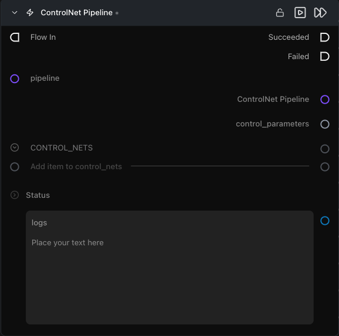

## When to use it

This node makes a generated image follow guide images you supply. A ControlNet is an add-on model that reads a guide image, such as an edge map, a depth pass or a pose, and steers the result to match it. This node attaches one or more ControlNets to a pipeline, which is the loaded model.

You have a pipeline from [Build Pipeline](LatentDiffusionPipelineBuilderNode.md) and one or more [Load ControlNet](ControlNetNode.md) nodes. Put this node between them and [Generate Latent](DiffusionPipelineGenerateLatentNode.md).

## What it needs

- A base pipeline. A pipeline that already has ControlNets is rejected, so do not chain two Apply ControlNet nodes.
- At least one connected ControlNet. Each must use the same provider as the pipeline.
- A pipeline type that supports ControlNets. These are Flux, Qwen, Stable Diffusion (SDXL), Stable Diffusion 3 and Z-Image pipelines. Flux Kontext, Flux 2, Flux 3, Qwen Edit and the video pipelines do not. For those, the run stops with a message that names the pipeline class.
- For Z-Image, one ControlNet only, and the base pipeline must be built with `cpu_offload_strategy` set to `None`.

## Where it fits

```text
Build Pipeline ────→ [Apply ControlNet] → Generate Latent → Convert Latent to Media
Load ControlNet ───┘                  └──→ control_parameters → Generate Latent
Load ControlNet ───┘
```

## Preview



## Parameters

### pipeline

The base pipeline from Build Pipeline.

### control_nets

One entry for each [Load ControlNet](ControlNetNode.md) node. To stack several ControlNets, add them all to this list on one node. Flux, Qwen, Stable Diffusion and Stable Diffusion 3 accept several. Z-Image accepts one.

### controlnet_pipeline

The pipeline with ControlNet support. Connect it to the `pipeline` input of Generate Latent.

### control_parameters

The settings of all connected ControlNets, passed along unchanged. Connect it to the `controlnet_parameters` input of Generate Latent.

### logs

Build messages, including the pipeline's configuration hash.

## Tips

- When the base pipeline is already loaded in memory, it is reused and only the ControlNet weights are loaded for this step. Otherwise the base pipeline is built in full first.
- Connect `controlnet_pipeline` to [Estimate Pipeline Memory](PipelineMemoryEstimateNode.md) to see the memory cost of each stacked ControlNet. This works before or after the pipeline is built.

## See also

- [Load ControlNet](ControlNetNode.md)
- [Build Pipeline](LatentDiffusionPipelineBuilderNode.md)
- [Estimate Pipeline Memory](PipelineMemoryEstimateNode.md)
