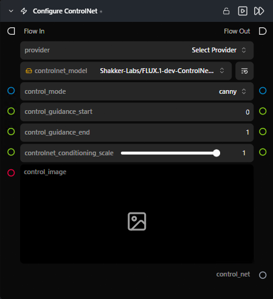

## When to use it

You have a control image, such as a canny edge map or a depth pass rendered from a plate, and want the generated image to follow it. Each node holds one ControlNet. To stack several, add one node for each and connect them all to [Apply ControlNet](ControlNetDiffusionPipelineBuilderNode.md).

## What it needs

- A control image that matches the ControlNet model. A depth model needs a depth map and a canny model needs an edge map. A mismatched image gives weak or no guidance.
- Run your edge, depth or pose detector in an earlier node. This node uses the image as it is.
- A ControlNet model for the chosen provider, already downloaded. Set `provider` first, because the model list and the extra settings change with it.
- A `control_image`, unless the model is one of the inpainting ControlNets. Without one the run stops with the message `Control image parameter cannot be None`.

## Where it fits

```text
Load Image → [Load ControlNet] → Apply ControlNet → Generate Latent
```

## Preview



## Example

You have a depth pass from a 3D render of a set and want a painted look that keeps the layout. Load the depth pass, set `provider` to the model family of your pipeline, and pick a depth ControlNet in `controlnet_model`. Connect `control_net` to Apply ControlNet.

## Parameters

### provider

The model family this ControlNet is for: Flux (default), Qwen, Stable Diffusion, Stable Diffusion 3 or Z-Image. It must match the provider of the pipeline. Apply ControlNet stops the run with a message if they differ.

### controlnet_model

The ControlNet to use. The choices depend on `provider`, and only models you have downloaded are listed. Models your license does not allow are listed but marked as not permitted, and the run stops with a message if you pick one.

### control_image

The image that guides the result. For the inpainting ControlNets (Qwen and Stable Diffusion 3) this input is hidden and not needed.

### controlnet_conditioning_scale

Slider from 0.0 to 1.0, default 1.0. Higher values follow the control image more closely. At 0.0 the ControlNet has no effect. Each ControlNet node has its own value when you stack them.

### control_mode

Flux only. The kind of control image you are supplying: `canny` (default), `tile`, `depth`, `blur`, `pose`, `gray` or `low_quality`. It must match what the image shows.

### control_guidance_start and control_guidance_end

Every provider except Z-Image. The part of the denoising steps where the ControlNet applies, as a fraction from 0.0 to 1.0. The defaults are 0.0 and 1.0, which covers the whole run. Lowering `control_guidance_end` lets the model fill in detail freely in the last steps.

### control_net

The configured ControlNet. Connect it to the `control_nets` input of Apply ControlNet.

## See also

- [Apply ControlNet](ControlNetDiffusionPipelineBuilderNode.md)
- [Build Pipeline](LatentDiffusionPipelineBuilderNode.md)
- [Estimate Pipeline Memory](PipelineMemoryEstimateNode.md)
