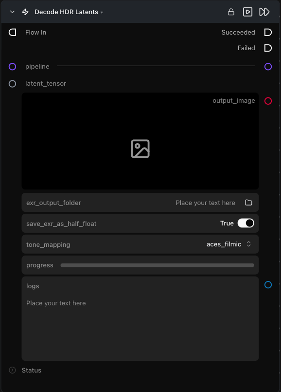

## When to use it

You have a latent from an HDR-capable pipeline and want two things from it. One is the unclipped float frames, for [Save EXR Sequence](SaveExrNode.md). The other is a preview image or video you can check right away. For ordinary pipelines, use [Decode Media](VaeDecodeNode.md).

## What it needs

- The same pipeline that produced the latent. Each pipeline uses its own VAE, and a different one gives corrupt output.
- A latent with image dimensions set. A latent without them stops the run with a message.

## Where it fits

```text
Generate Latent → [Decode HDR Media] ─┬→ preview image or video
                                      └→ raw_media → Save EXR Sequence
```

## Preview



## Example

You generated an HDR plate for a comp. Connect `raw_media` to Save EXR Sequence to write the frames to disk with the values unchanged. Use the preview to check the shot before you open it in the compositing app.

## Parameters

### pipeline

Connect the pipeline that produced the latent.

### latent_tensor

The latent to decode. It is shown as `input_latent` on the node. Large or multi-frame latents need more memory to decode. If memory runs short, turn on `vae_tiling` on [Build Pipeline](LatentDiffusionPipelineBuilderNode.md).

### tone_mapping

How float values are squeezed into a displayable range for the preview. The default is `aces_filmic`.

- `None`: clip values to 0 to 1 and show them as they are.
- `clip`: clamp values to the range 0 to 1.
- `reinhard`: smooth highlight compression.
- `aces_filmic`: film-like highlight compression.
- `cv2_reinhard` and `cv2_mantiuk`: the OpenCV versions of those operators.

Every option except `None` assumes the decoded values are linear and converts the result to sRGB. Whether the values are linear depends on the model pipeline, so judge the preview by eye. The setting changes only the preview. `raw_media` is never affected.

### fps

Video pipelines only. The frame rate of the preview video, a whole number of 1 or more (the field offers 1 to 120). It starts at the model's own rate. If the model also generates audio, the preview is encoded at the model's rate whatever you set, so sound and picture stay in sync.

### raw_media

The decoder's float RGB frames, unchanged. Range and color space depend on the model pipeline. Connect it to Save EXR Sequence. It is held in memory only and is not saved with the workflow, so run the decoder and the saver in the same run.

### output_image

Image pipelines only. The tone-mapped preview image.

### output_video

Video pipelines only. The tone-mapped preview as an MP4, with audio when the model generates it.

## See also

- [Decode Media](VaeDecodeNode.md)
- [Generate Latent](DiffusionPipelineGenerateLatentNode.md)
- [Save EXR Sequence](SaveExrNode.md)
