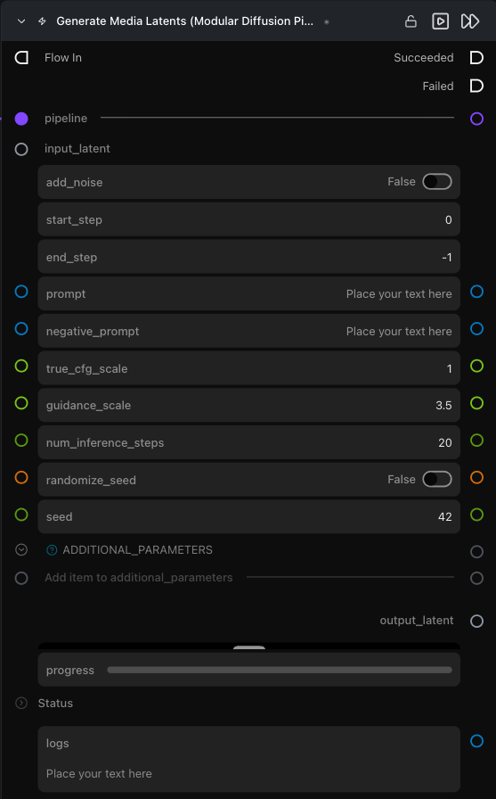

## When to use it

This is the node that makes the picture or the clip. It starts from a [latent](../guides/what-is-a-latent.md), the compressed form of a picture or clip that the model works on, and cleans noise out of it over many steps until an image or video emerges. Connect a pipeline (the loaded model) and a starting latent, write the prompt, and run. The output is a latent, so pass it to [Decode Media](VaeDecodeNode.md) to get an image or video.

The settings below the inputs depend on the connected pipeline. They appear when you connect it and change if you swap it for another one. Connections to settings with the same name are kept.

Some models add inputs or change defaults. Those are listed in [Generate Latent by model](../guides/generate-latent-by-model.md).

## What it needs

- A pipeline from [Build Pipeline](LatentDiffusionPipelineBuilderNode.md), [Apply ControlNet](ControlNetDiffusionPipelineBuilderNode.md) or [Apply Runtime LoRA](LoraActivationPipelineNode.md).
- A starting latent. Width, height and frame count come from this latent, so set them on [Create Noise Latent](NoiseLatentNode.md) or whichever node makes it.

## Where it fits

```text
[Build Pipeline] → [Create Noise Latent] → [Generate Latent] → [Decode Media]
```

## Preview



## Example

You are building a clean plate. Run Generate Latent from a noise latent for the first pass, then feed its output into a second Generate Latent with `add_noise` on and `start_step` at 10 (with the default 20 steps) to refine the result. The second pass keeps the layout of the first.

## Parameters

### input_latent

The starting latent. What you connect sets the mode:

- A noise latent from [Create Noise Latent](NoiseLatentNode.md): text-to-image or text-to-video.
- An empty latent from [Create Empty Latent](EmptyLatentNode.md): the same, with `add_noise` on.
- An encoded image or a previous Generate Latent output: image-to-image or refinement. Turn `add_noise` on to blend noise into it.
- The output of [Encode Masked Media](VaeMaskEncodeNode.md): inpainting. The node switches to the inpaint pipeline, uses the strength from that node and hides `add_noise`. Pipelines without an inpaint variant, such as the video pipelines, `Flux2Pipeline` and Flux3, stop the run with a message.
- The output of [Set Latent Mask](SetLatentMaskNode.md): masked denoising. See [Masked denoising](../guides/generate-latent-by-model.md#masked-denoising).

### controlnet_parameters

Appears when the pipeline came from Apply ControlNet. Connect the `control_parameters` output of that node. The run stops with a message if it is missing.

### additional_parameters

Optional extra settings passed on to the pipeline, such as conditioning from a media conditioning node.

### prompt

What to generate.

### negative_prompt

What to steer away from. Only pipelines that support it show it.

### guidance_scale

How closely the result follows the prompt. Higher values follow it more strongly. Some pipelines use `true_cfg_scale` instead, and some have no guidance setting.

### num_inference_steps

The length of the denoising schedule. It defaults to 20 unless the model sets its own value. See the model guide for LTX2, Flux3 and WAN Animate 2.

### seed

The same seed with the same settings gives the same result. The default is 42. This seed is used when the input latent carries no random state of its own. A latent from Create Noise Latent usually does, so the seed set there applies instead.

### randomize_seed

Off by default. When on, a new random seed is chosen at the start of each run and written to `seed`.

### add_noise

Off by default. When on, the input latent is blended with noise before denoising. A higher `start_step` adds less noise and keeps more of the input. A `start_step` of 0 adds the most noise and mostly ignores the input.

Turn it on whenever the input is an empty latent, an encoded image or a masked latent from Set Latent Mask. With it off, denoising starts from the input as it is.

### start_step

The step to begin from, counting from 0. The default is 0. Use a higher value to continue from a partly denoised latent, or to keep more of an encoded image. It must be less than `num_inference_steps`, and less than `end_step` unless `end_step` is -1. The run stops with a message otherwise.

### end_step

The step to stop at, counting from 0. The default is -1, which runs to the end. It cannot be greater than `num_inference_steps`. A lower value leaves the latent partly noised for a later stage. Chain two Generate Latent nodes, for example steps 0 to 10 and then 10 to 20, for multi-stage refinement.

### return_fully_denoised

Off by default. When on, the last step aims at a fully clean latent, so stopping early with `end_step` still gives a denoised result. The step count does not change. MiniMax-H3 and WAN Animate 2 stop the run with a message when it is on. A scheduler with no sigmas ignores it. See the model guide.

### preview_image

Live pictures of the intermediate steps. It fills only when **Enable Image Preview Intermediates** is on in Settings, in the Modular Diffusion Library section. That setting is off by default and slows each run.

### output_latent

The denoised latent.

### logs

Timing for each step.

## Tips

- Cancel stops the run after the current step.

## See also

- [Generate Latent by model](../guides/generate-latent-by-model.md)
- [Build Pipeline](LatentDiffusionPipelineBuilderNode.md)
- [Create Noise Latent](NoiseLatentNode.md), [Encode Media](VaeEncodeNode.md) and [Encode Masked Media](VaeMaskEncodeNode.md)
- [Decode Media](VaeDecodeNode.md)
