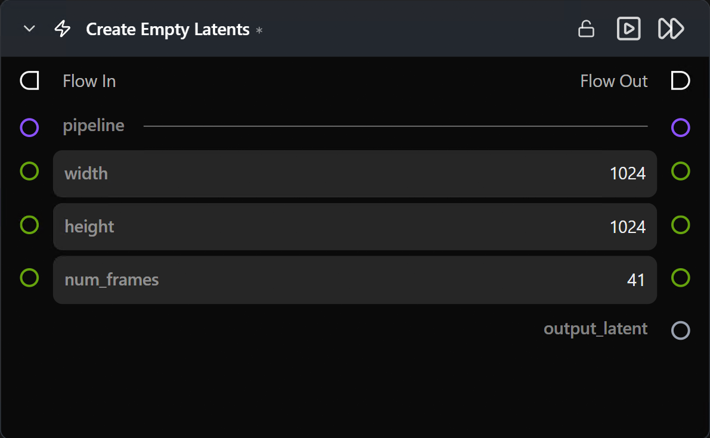

## When to use it

You want a blank latent of the right size. It works well as the base that [Composite Latents with Mask](LatentCompositeMaskNode.md) pastes other latents onto. For ordinary text-to-image or text-to-video, use [Create Noise Latent](NoiseLatentNode.md) instead.

## What it needs

- A pipeline, which sets the latent's shape and whether `num_frames` is shown.
- Noise added before denoising. A latent of zeros has nothing to denoise from, so set `add_noise` to on in [Generate Latent](DiffusionPipelineGenerateLatentNode.md), or add noise with the composite and math nodes first.

## Where it fits

```text
Build Pipeline → [Create Empty Latent] → Composite Latents with Mask → Generate Latent
```

## Preview



## Parameters

### pipeline

Connect the pipeline you will generate with. The latent only works with that kind of pipeline.

### width and height

Size in pixels. Both default to 1024. They must be at least 1. Some pipelines need sizes that are a multiple of a set number. If yours does and your size does not fit, the run stops with a message. Turn on **Auto Resize** under Library Settings > Diffusion Library to round the size up automatically.

### num_frames

Video pipelines only. The number of frames, default 41. It must be at least 1, and some pipelines need specific counts, which Auto Resize also adjusts. Image pipelines hide this setting.

### output_latent

A latent of zeros. There is no seed, so the result is always the same.

## See also

- [Create Noise Latent](NoiseLatentNode.md)
- [Composite Latents with Mask](LatentCompositeMaskNode.md)
