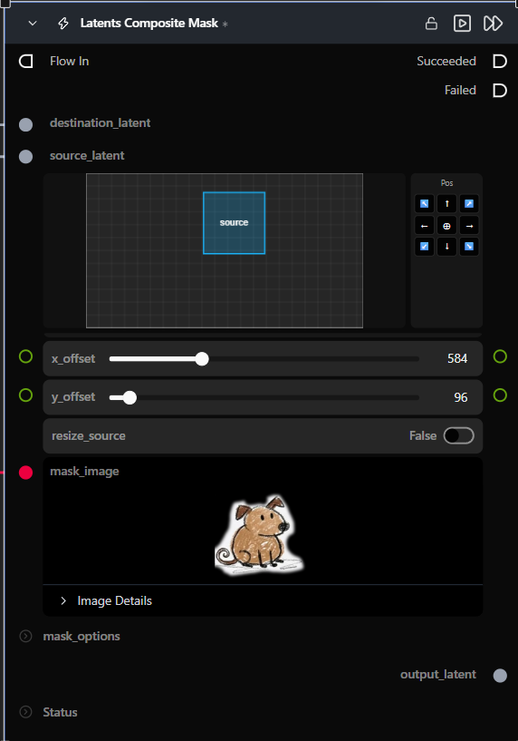

## When to use it

This node places one [latent](../guides/what-is-a-latent.md) inside another, like laying a foreground element over a background plate. A latent is the compressed form of a picture or clip that the model works on.

You have two latents and want one placed inside the other. White areas of the mask show the source, black areas keep the destination. With no mask, the source replaces the destination wherever it lands.

## Where it fits

```text
Generate Latent (destination) ──┐
Generate Latent (source) ───────┼─→ [Composite Latents with Mask] → Generate Latent
Mask image ─────────────────────┘
```

## Preview



## Parameters

### destination_latent

The base latent. The output takes its size from this latent. Metadata from both latents is merged, and this latent wins when both have the same key.

### source_latent

The latent to paste in. Use two image latents or two video latents, not one of each.

### placement_editor

Drag the source box over the destination, or pick a position preset. It writes `x_offset` and `y_offset`, snapped to multiples of 8, and sets `resize_source`. A connected offset is left to its connection.

The editor shows the latent sizes only after the node has run once. Until then it is blank. Place the source in the editor and the sizes are saved with the workflow.

### x_offset and y_offset

Where the source goes, in pixels, default 0. The sliders run from -2000 to 2000 and larger values are accepted. The node divides them by 8 to get latent units. Negative values let the source hang off the top or left edge.

Only the part of the source that overlaps the destination is used. If the source misses the destination entirely, nothing is composited and `output_latent` is not updated.

### resize_source

Off by default. When on, the source is scaled to the destination's size before it is placed. Use it with image latents. The offsets still apply, so a non-zero offset shifts the scaled source and cuts off its far edge. Picking a position preset in the editor sets the offsets back to 0, 0.

### mask_image

Optional. The mask is resized to the source's size automatically. The same parameter also works as an output, so the mask you paint in the node can feed other nodes.

### channel

Which channel of the mask image sets the blend: `red` (default), `green`, `blue` or `alpha`. Found under mask options, which start collapsed.

### invert_mask

Off by default. Swaps the source and destination areas.

### grow_shrink

Slider from -100 to 100, default 0. Positive values shrink the mask edge and negative values grow it.

### blur_mask

Slider from 0 to 100, default 0. Softens the mask edge.

### output_latent

The destination with the source composited in. A mask is spread across all frames of a video latent.

## See also

- [Create Empty Latent](EmptyLatentNode.md)
- [Add Latents](AddLatentsNode.md)
