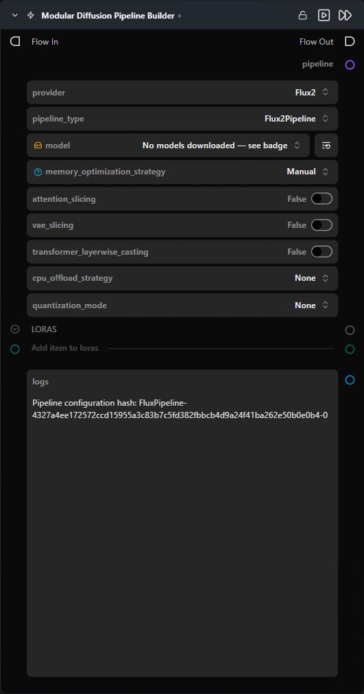

## When to use it

Every diffusion workflow starts here. Pick the model family and checkpoint, set how memory is used, and connect `pipeline` to each node that needs the model.

The pipeline is built once and kept in memory. Changing a load-time setting, such as the checkpoint, the memory settings or the LoRAs, rebuilds it. Prompts and step counts are set on other nodes and never trigger a rebuild.

MiniMax-H3, Flux3 and WAN Animate 2 do not use the quantization, layerwise casting and CPU offload settings, and LTX2 offers its own checkpoint entries. See [Build Pipeline by model](../guides/build-pipeline-by-model.md).

## What it needs

- A model downloaded in Model Manager. Nothing is downloaded when the pipeline is built.
- The same model family for any LoRA, ControlNet or component override you connect.
- Enough GPU memory for the model. See the memory settings in [the guide](../guides/build-pipeline-by-model.md#memory-settings).

## Where it fits

```text
[Build Pipeline] → Create Noise Latent → Generate Latent → Decode Media
```

## Preview



## Example

You are generating a clean plate with Flux. Set `provider` to `Flux`, `pipeline_type` to `FluxPipeline` and pick the Flux checkpoint in `model`. Connect `pipeline` to Create Noise Latent, Generate Latent and Decode Media. All three share the one loaded model. Set `provider` first, because changing it returns `pipeline_type` and the model settings to their defaults.

## Parameters

### provider

The model family: `Flux`, `Flux2`, `Flux3`, `HunyuanVideo 1.5`, `LTX`, `LTX2`, `MiniMax-H3`, `Qwen`, `Stable Diffusion`, `Stable Diffusion 3`, `WAN` or `Z-Image`. Changing it resets `pipeline_type` to the first type of the new family and returns the model settings to their defaults. Connections stay where the setting names match. Memory settings and LoRAs keep their values, and the component override ports follow the new pipeline type. You can connect a string to drive it.

### pipeline_type

The variant within the family, such as `FluxPipeline` or `WanImageToVideoPipeline`. It decides what the pipeline can do, which checkpoints are offered and which settings appear. You can connect a string to drive it. Setting a type that belongs to another family switches `provider` to match.

### model

The checkpoint, chosen from the models downloaded for this pipeline type. A standard entry is a model in Diffusers format. To use a single-file checkpoint, connect a [Load Component](LoadComponent.md) node to a component override instead. Models your license does not allow are listed but marked as not permitted, and the run stops with a message if you pick one. You can connect a string, which replaces the picker.

### memory_optimization_strategy

`Manual` (default) shows the memory settings. `Automatic` hides them, including `quantization_mode`, and chooses settings from the GPU memory available. The individual settings are described in [Memory settings](../guides/build-pipeline-by-model.md#memory-settings).

### quantization_mode

`None` (default), `fp8`, `int8` or `int4`. Shrinks the model weights. Each step saves more memory and costs more quality and speed. Models that already ship quantized weights skip it.

### loras

Connect one or more [Load LoRA](LoadLora.md) nodes. They are fused into the model weights. Changing or removing one rebuilds the pipeline. To change LoRAs between runs without a rebuild, use [Apply Runtime LoRA](LoraActivationPipelineNode.md) instead.

### component_overrides

A group of ports, one per part of the model, such as Transformer or VAE. Connect a [Load Component](LoadComponent.md) node to a port to replace that part of the model with your own weights. MiniMax-H3, Flux3 and WAN Animate 2 have no ports. Messages for replacements that do not fit are in [Component overrides](../guides/build-pipeline-by-model.md#component-overrides).

### pipeline

The built and cached pipeline. Connect it to every node that takes a `pipeline` input.

### logs

Build messages, including the pipeline's configuration hash.

## Tips

- If the model does not fit in GPU memory, try these in order: set `quantization_mode` to `int8` or `int4`, set `cpu_offload_strategy` to `Model`, turn on `vae_slicing`. Each trades some speed for memory.
- If a LoRA has no effect, check that it was trained for the same model family as `pipeline_type`, and that it is connected to `loras`.
- The cache is held in memory. After a restart, the next run builds the pipeline again.

## See also

- [Load ControlNet](ControlNetNode.md) and [Apply ControlNet](ControlNetDiffusionPipelineBuilderNode.md)
- [Load LoRA](LoadLora.md)
- [Load Component](LoadComponent.md)
- [Build Pipeline by model](../guides/build-pipeline-by-model.md)
- [Generate Latent](DiffusionPipelineGenerateLatentNode.md)
