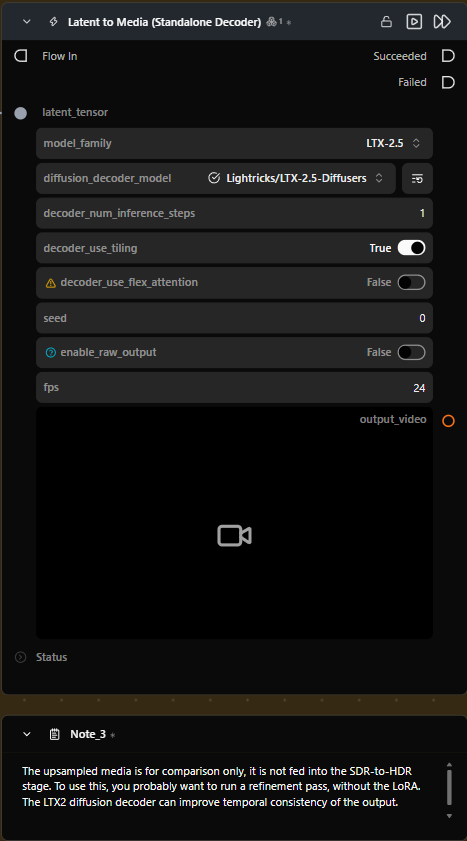

## When to use it

This node turns a [latent](../guides/what-is-a-latent.md) into a picture or video you can view. A latent is the compressed form of a picture or clip that the model works on. This node loads its own decoder model, so it needs no connected pipeline.

Use it when you have a video latent from an LTX-2 pipeline and want to decode it without connecting a pipeline. For latents decoded with the pipeline's own decoder, the [VAE](../guides/what-is-a-vae.md), use [Decode Media](VaeDecodeNode.md).

The LTX-2.5 diffusion decoder is the only model family available.

## What it needs

- The decoder weights downloaded in advance. Download the `Lightricks/LTX-2.5-Diffusers` repo in Model Manager before the first run.
- A video latent made by an LTX-2 family pipeline. Latents from other models are not meant for this decoder. A latent that does not have 5 dimensions stops the run with a message that shows its shape.

## Where it fits

```text
Generate Latent → [Convert Latent to Media] → Save Video
```

## Preview



## Parameters

### model_family

The decoder to use. The default and only choice is `LTX-2.5`. Changing it replaces the settings that belong to the family.

### latent_tensor

The latent to decode.

### seed

Default 0. The same seed gives the same result. Use -1 to leave the random generator unset.

### enable_raw_output

Off by default. When on, `raw_media` appears. The image or video output is still produced, as a separate preview clipped to 0 to 1.

### fps

Frame rate of the video, a whole number of 1 or more (the field offers 1 to 120). The default is 24.

### diffusion_decoder_model

The decoder weights. The only choice is `Lightricks/LTX-2.5-Diffusers`.

### decoder_num_inference_steps

Number of denoising steps for the decoder. The default is 1 and the value must be at least 1.

### decoder_use_tiling

On by default. Decodes large videos in overlapping tiles, which lowers peak memory. Leave it on for large videos.

### decoder_use_flex_attention

Off by default. The decoder uses a chunked attention method that keeps memory low. Set it to on to use the original FlexAttention method instead. At video sizes that can need tens of GB of GPU memory and may run out of it. Turn it on only when you need to match the original decoder's behavior.

### output_video

The decoded video as an MP4. This node produces no audio.

### raw_media

Only with `enable_raw_output` on. The decoder's float RGB frames, with shape (frames, height, width, 3) for video. The range is not standardized. For latents from the LTX-2 HDR pipeline, the values are converted back from LogC3 to linear. It is held in memory only and is not saved with the workflow.

## See also

- [Generate Latent](DiffusionPipelineGenerateLatentNode.md)
- [Decode Media](VaeDecodeNode.md)
