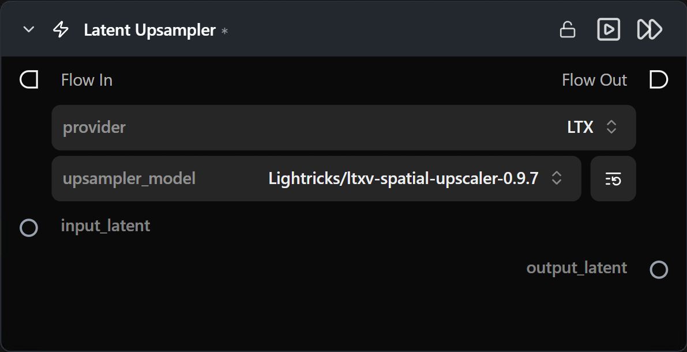

## When to use it

You generated a low-resolution video latent and want it larger before a refinement pass. Upsampling in latent space skips the decode, upscale and re-encode round trip. The result is twice the width and twice the height.

## What it needs

- A latent from the same model family as the upsampler. An LTX2 upsampler gives no sensible result for a latent from another family.
- The upsampler weights downloaded in advance, through Model Manager.

## Where it fits

```text
Generate Latent (low-res) → [Upsample Latent] → Generate Latent (refine) → Convert Latent to Media
```

## Preview



## Parameters

### provider

The upsampler family: `LTX` (default) or `LTX2`. Changing it replaces the model list.

### upsampler_model

The upsampler weights, from the repos for the chosen provider. Only repos you have downloaded are listed. Models your license does not allow are listed but marked as not permitted, and the run stops with a message if you pick one.

| Provider | Models |
|----------|--------|
| `LTX` | `Lightricks/ltxv-spatial-upscaler-0.9.7` |
| `LTX2` | `dg845/LTX-2.3-Spatial-Upsampler-Diffusers`, `Lightricks/LTX-2.5-Diffusers` |

### input_latent

The latent to upsample.

### output_latent

The upsampled latent. The upsampler does not remove noise or add detail, so follow it with a short [Generate Latent](DiffusionPipelineGenerateLatentNode.md) pass. The input's metadata is copied to the output, so provider data such as LTX2 audio latents is still there for the next stage.

## See also

- [Generate Latent](DiffusionPipelineGenerateLatentNode.md)
- [Decode Media](VaeDecodeNode.md)
