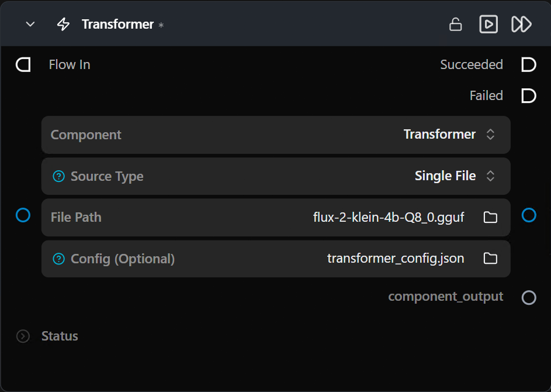

## When to use it

You have a particular model file or folder, such as a GGUF [transformer](../guides/what-is-a-transformer.md#why-swap-it), a [text encoder](../guides/what-is-a-text-encoder.md#why-swap-it) or a fine-tuned [VAE](../guides/what-is-a-vae.md#why-swap-the-vae), and want Build Pipeline to use it for one slot. This node describes where the weights are. [Build Pipeline](LatentDiffusionPipelineBuilderNode.md) loads them when it builds the pipeline.

## What it needs

- Weights already on your machine. Nothing is downloaded. For a Hugging Face repo, download it first in Model Manager.
- A component override port on Build Pipeline that fits the chosen component. A loader for a kind of component can also feed the numbered ports of that kind, such as Text Encoder 2 or Transformer 2.

## Where it fits

```text
[Load Component] → Build Pipeline (component override) → Generate Latent
```

## Preview



## Parameters

### component

Which pipeline slot this loader is for: [`Transformer`](../guides/what-is-a-transformer.md) (default), [`UNet`](../guides/what-is-a-transformer.md), [`VAE`](../guides/what-is-a-vae.md), [`Tokenizer`](../guides/what-is-a-text-encoder.md) or [`Text Encoder`](../guides/what-is-a-text-encoder.md). Changing it changes the output type and removes any connection from `component_output`, so reconnect it afterward.

### source_type

Where the weights are stored: `Single File` (default), `Local Folder` or `HuggingFace Repo`. Only the settings for the chosen source are shown. `Tokenizer` has no `Single File` choice, because a tokenizer is made of vocabulary and config files. If it was set to `Single File`, it switches to `Local Folder`.

### file_path

Single File only. The full path to one weight file. The file picker offers `.gguf`, `.safetensors`, `.ckpt`, `.pt`, `.pth` and `.bin`. For `Text Encoder`, it offers only `.gguf`. If no file exists at the path, the run stops with a message.

### config_source

Single File only, optional. A `config.json` file, a folder that contains one, or a Hugging Face repo ID that is already downloaded. Leave it empty to find a config automatically from the downloaded models. The automatic search can fail, so set this when it does. For GGUF weights, point it at the component's folder or its `config.json`.

### folder_path

Local Folder only. The component's own folder in diffusers format, such as `.../FLUX.1-dev/transformer/`, not the model's top folder. The folder must contain `config.json` plus weights. For `Tokenizer` it must contain `tokenizer_config.json`. A folder with a `.gguf` file does not work here. Use `Single File` for GGUF.

Supported weight files are `diffusion_pytorch_model.safetensors`, `diffusion_pytorch_model.bin`, and a sharded set with its `.index.json`.

### repo_id

HuggingFace Repo only. The repo in `owner/name` form, such as `black-forest-labs/FLUX.1-dev`. It must already be downloaded. A refresh button next to the field checks again. If the repo is missing, an **Open Model Manager to Download** button appears under the field, and the run stops with a message if you run without it.

### revision

HuggingFace Repo only. A branch, tag or commit. The default is `main`.

### subfolder

HuggingFace Repo only, optional. The folder inside the repo that holds the component. Leave it empty and the node looks for a folder named after the Build Pipeline port it feeds, such as `transformer_2` or `text_encoder_2`. If there is none, it tries the component's own name (`transformer`, `unet`, `vae`, `tokenizer` or `text_encoder`), then the top of the repo. It uses the first one that has a config file. Type the folder name to choose it yourself.

### component_output

The description of the component. Connect it to the matching component override port on Build Pipeline. Changing any value here, including `revision` and `subfolder`, makes Build Pipeline rebuild the pipeline.

## See also

- [Build Pipeline](LatentDiffusionPipelineBuilderNode.md)
- [Load LoRA](LoadLora.md)
