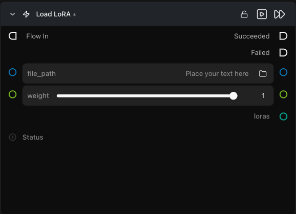

## When to use it

This node loads a LoRA, a small add-on file that was trained separately to give a model a style, character or effect. It sets the LoRA's weight, which is how strongly it applies.

You have a LoRA file and want to apply it to a model. The node holds one LoRA. To stack several, add one node for each and connect them all to the same consumer.

There are two ways to use it. Connect it to [Build Pipeline](LatentDiffusionPipelineBuilderNode.md) to fuse it into the model weights. Connect it to [Apply Runtime LoRA](LoraActivationPipelineNode.md) to switch it on for each generation only.

## What it needs

- A LoRA file on disk. The file picker offers `.safetensors`, `.sft`, `.pt`, `.bin`, `.json` and `.lora`. If the file is missing, the run stops with a message that shows the path.
- A LoRA made for the same model family as the pipeline, such as a Flux LoRA for a Flux pipeline.

## Where it fits

```text
# Fused at build time:
[Load LoRA] ─┐
[Load LoRA] ─┼─→ Build Pipeline → Generate Latent
[Load LoRA] ─┘

# Applied per generation:
Build Pipeline ─┐
[Load LoRA] ────┼─→ Apply Runtime LoRA → Generate Latent
[Load LoRA] ────┘
```

## Preview



## Example

A studio trains a LoRA on the look of a show. Use fusing in Build Pipeline when every shot in the workflow uses that look. Use Apply Runtime LoRA when one branch of the workflow uses it and another does not.

## Parameters

### file_path

The path to the LoRA file. Hugging Face repo IDs do not work here. Download the file first.

### weight

Slider from 0.0 to 1.0, default 1.0. Higher values make the LoRA stronger and 0.0 turns it off. Each LoRA node has its own weight.

With Build Pipeline, the weight is fixed when the pipeline is built, so changing it rebuilds the pipeline. With Apply Runtime LoRA, you can change it between runs without a rebuild.

### trigger_phrase

Hidden by default. A phrase the LoRA was trained to respond to. It is passed along with the LoRA but is not added to your prompt, so type the trigger word into the prompt yourself. The parameter also has an output, so you can connect it to a text input such as a prompt.

### loras

The LoRA with its path, weight and trigger phrase. Connect it to the `loras` input of Build Pipeline or Apply Runtime LoRA.

## See also

- [Build Pipeline](LatentDiffusionPipelineBuilderNode.md)
- [Apply Runtime LoRA](LoraActivationPipelineNode.md)
