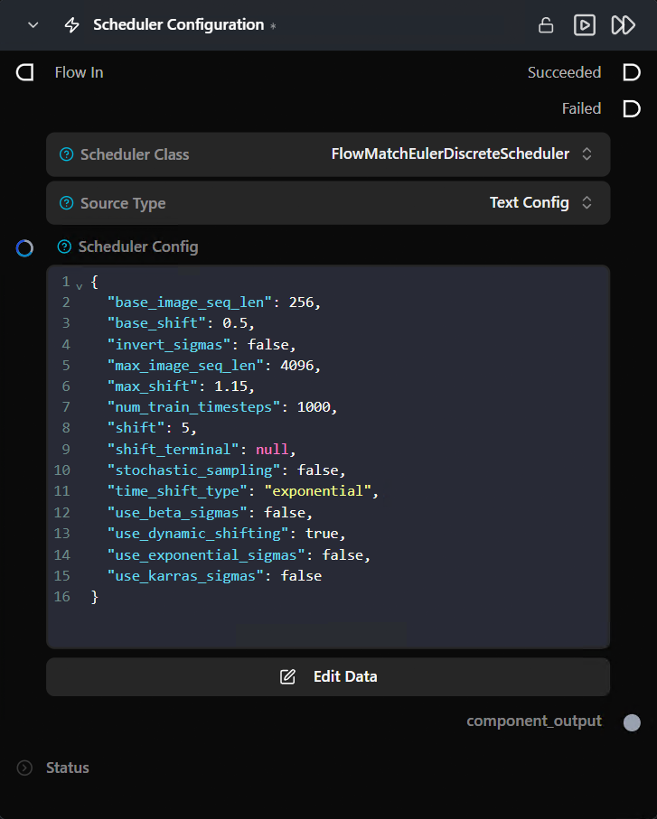

## When to use it

This node picks a different scheduler for a model. The scheduler controls how the model cleans noise out of the picture, step by step.

Use it when you want to change how a model steps through that clean-up without touching its weights. [What is a scheduler?](../guides/what-is-a-scheduler.md) explains what it controls. A scheduler is only a set of settings, so there is nothing large to load. Connect the result to the `scheduler` input of [Build Pipeline](LatentDiffusionPipelineBuilderNode.md).

## Where it fits

```text
[Load Scheduler] → Build Pipeline → Generate Latent
```

## What it needs

- A scheduler class from the same family as your model. Flow-matching classes (`FlowMatch*`, `LTXEulerAncestralRFScheduler`) are for Flux, SD3, Qwen, Wan and LTX. Classic classes (Euler, DDIM, DPMSolver, UniPC and similar) are for SDXL. A class from the wrong family gives wrong output or an error during generation.
- For **HuggingFace Repo**, a repo that is already in your local cache. Nothing is downloaded.



## Parameters

### scheduler_class

The scheduler to use. The list is searchable. The default is `FlowMatchEulerDiscreteScheduler`.

### source_type

Where the settings come from. Only the fields for the chosen source are shown.

- **Local Path** (default): a `scheduler_config.json` file.
- **HuggingFace Repo**: a repo in your local cache.
- **Text Config**: JSON typed or pasted into the node, or connected from another node.

The scheduler class you pick is always the one used. The `_class_name` stored in a config file is ignored.

### config_path

A `scheduler_config.json` file, or a folder that contains one, such as `.../FLUX.1-dev/scheduler/`. Point at the `scheduler` folder, not the pipeline root.

### repo_id

A HuggingFace repo id, such as `black-forest-labs/FLUX.1-dev`. The refresh button next to the field checks the local cache again. If the repo is not cached, an **Open Model Manager to Download** button opens Model Management filtered to that repo.

### revision

Branch, tag or commit of the repo. The default is `main`.

### subfolder

The folder in the repo that holds `scheduler_config.json`. Leave it empty to use `scheduler`.

### text_config

The contents of a `scheduler_config.json`. Paste it, or connect a **JSON Input**, **Create Dictionary** or **Merge Key Value Pairs** node. Dictionaries and JSON text are both accepted, and the text is reformatted after each edit.

Leave it empty to use the scheduler class's built-in defaults. If the JSON has keys the chosen class does not use, a warning lists them. The scheduler still loads and those keys are ignored.

### component_output

The scheduler. Connect it to the `scheduler` input of Build Pipeline.

## Tips

- A warning appears when the config names a scheduler class from a different family than the class you chose. The chosen class is still used.
- With no source filled in, the run stops with a message asking for a path, a repo id or a pasted config. In **Text Config** an empty field is fine.
