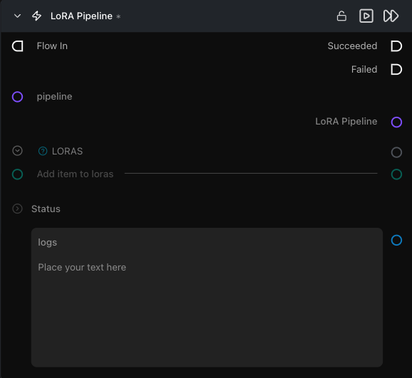

## When to use it

This node switches LoRAs on for a generation without changing the loaded model. A LoRA is a small add-on file that gives a model a style, character or effect.

You have a built pipeline, which is the loaded model, and one or more LoRAs. You want the LoRAs applied only while generating. The base model stays as it was, so another branch can use it with no LoRAs. This suits in-context LoRAs, distillation or acceleration LoRAs, and slider LoRAs.

## Where it fits

```text
Build Pipeline ────┐
                   ├─→ [Apply Runtime LoRA] → Generate Latent → Decode Media
Load LoRA ─────────┘
```

## What it needs

- A pipeline from [Build Pipeline](LatentDiffusionPipelineBuilderNode.md). Without one the run stops with a message.
- At least one LoRA from [Load LoRA](LoadLora.md). Without one, the run stops with a message.



## Parameters

### pipeline

The base pipeline from Build Pipeline. It is reused without changes, so you can connect it to other nodes too.

### loras

Connect one or more Load LoRA nodes to stack them. The adapters are switched on for each generation and released afterward.

### lora_pipeline

The pipeline with the LoRAs attached. It shares the cached model of the input pipeline, so connecting it to Generate Latent does not load the model again. Connect the original pipeline to a second Generate Latent to compare with and without LoRAs.

### logs

The build log, including the pipeline configuration hash.

## Tips

- LoRAs connected to Build Pipeline are merged into the model weights. Changing them rebuilds the pipeline. LoRAs on this node can change between runs without a rebuild.
- When this node's output feeds [Estimate Pipeline Memory](PipelineMemoryEstimateNode.md), each distinct adapter file is counted once and its weight size is added to the transformer estimate. An adapter file that cannot be read adds nothing and produces a warning.
- Use Build Pipeline's own LoRA input only when the same LoRAs apply to every generation.
