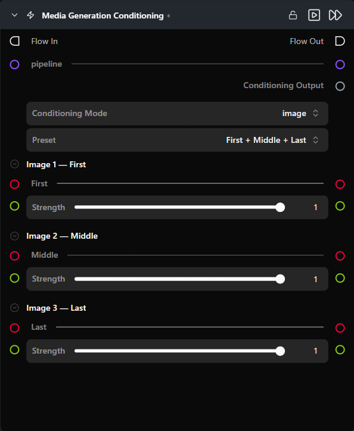

## When to use it

This node bundles footage you already have, as images or a video, so the model can use it as guidance. This guidance is called conditioning. Each item gets a frame position and a strength.

You want a generated clip or edited image to follow footage you already have. Feed it the first and last frame of a shot to bridge the gap between them, or a few reference stills to steer the look. Connect the result to the matching conditioning input on [Generate Latent](DiffusionPipelineGenerateLatentNode.md).

## Where it fits

```text
Build Pipeline ───────────────────────────────┐
                                              ├─→ Generate Latent → Decode
Load Image (first) ───┐                       │
Load Image (last)  ───┴→ [Reference Media] ───┘
```

## What it needs

- Connect the pipeline to this node first. The inputs change to the layout that suits that model.
- Fill every image or video input the node shows. A missing one stops the run with a message.
- Connect the same pipeline to Generate Latent. The input that takes `conditioning` appears there once the pipeline is connected. Its name depends on the model, for example `conditioning_images` for WAN Image-to-Video, `media_conditions` for LTX and LTX2, `source_media` for WAN VACE, `reference_images` for Flux2 and `references` for MiniMax-H3 ref2va.



## What each pipeline offers

| Pipeline | Layout |
|----------|--------|
| None connected | Image or video. Image presets: Custom (default), First + Middle + Last, First + Last, First frame. |
| LTX, LTX2 | Same as none connected, but First + Middle + Last is the default preset. |
| WAN Image-to-Video | Images only. Presets: First + Last (default), First frame. No strength. |
| WAN VACE | Image or video, image by default. The same presets as LTX, with no strength. Custom allows up to 8 images with no strength. Video has a frame index and no strength. |
| WAN Animate | Video only, with no strength or frame index. |
| MiniMax-H3 | Images only. Presets: First + Last (default), First frame. No strength. |
| MiniMax-H3 ref2va | Image or video, image by default. Up to 9 images, with no strength or frame position. |
| Flux2 Klein, Flux2 Dev | Images only, 1 to 8 images, with no strength or frame position. |
| Flux3, Flux3 Distilled | Images only, 1 to 10 images, with no strength or frame position. |
| Qwen Edit | Images only, 1 to 8 images, with no strength or frame position. |
| HunyuanVideo 1.5 Image-to-Video | First frame only, with no strength. |

For MiniMax-H3 ref2va, a video node holds one clip. Use one node per clip, up to three, and connect them all to `references`. Each clip must be at least 2 seconds, or the run stops with a message. All clips together should stay within 15 seconds: when they run longer, the last clip is shortened, or dropped if it cannot stay at 2 seconds, and a warning is shown. Clip audio is dropped.

A pipeline that does not support conditioning stops the run with a message.

## Parameters

### pipeline

Optional. Connecting a pipeline swaps the inputs to that model's layout. When the layout changes, connections to image and video inputs that exist in the new layout, and to `conditioning`, are reconnected. Disconnecting the pipeline leaves the current layout as it is.

### mode

Choose `image` or `video`. When the pipeline supports only one, only that choice is listed. Changing it rebuilds the inputs, so any images or video already connected to them are removed and the inputs start empty.

### image_preset

A named arrangement of image slots. The choices and the default depend on the pipeline. **Custom** lets you set any number of images and place each one yourself. Named presets lock the frame positions: with First + Last, the first image is pinned to the first frame and the second to the last. Presets have no frame index fields. Changing the preset or the number of images rebuilds all image inputs, so set them before you connect images.

### num_images

How many image inputs to show. It is shown for **Custom**, and for pipelines that take any number of images (Flux2, Flux3, Qwen Edit, MiniMax-H3 ref2va). Presets fix the count. The range is 0 to 8 with no pipeline connected, and differs for some pipelines (see the table). The default is the lowest number in the range.

### image_0

Present for every image slot as `image_N`, counting from 0. An image input. It is required: the run stops with a message if any shown image input is empty.

### image_0_frame_index

Present for every image slot as `image_N_frame_index`, counting from 0. The frame of the output video where that image is applied, starting at 0 for the first frame. Shown only for **Custom** on pipelines that place images by frame.

### image_0_strength

Present for every image slot as `image_N_strength`. A value from 0.0 to 1.0, default 1.0. Higher values follow the image more closely. Shown only on pipelines that use a strength.

### video

The conditioning video, shown in video mode. It is required in video mode.

### frame_index

In video mode, the frame of the output where the conditioning video starts. The default is 0.

### video_strength

In video mode, how strongly the video guides the result. A value from 0.0 to 1.0, default 1.0.

### conditioning

The package of images or video with their frame positions and strengths. Connect it to the matching input on Generate Latent.

## Tips

- To place an image at a specific frame, set **Custom** and use its frame index. Presets cannot be moved.
