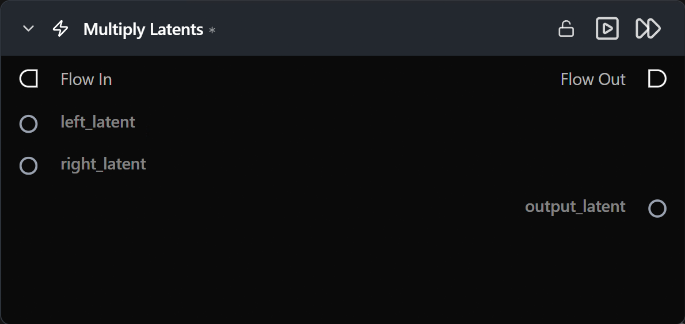

## When to use it

This node multiplies two [latent](../guides/what-is-a-latent.md) together, number by number. A latent is the compressed form of a picture or clip that the model works on.

You have two latents of the same shape and want their product. Scaling a latent by a near-constant latent is the most predictable use. Multiplying two unrelated latents tends to give unexpected results.

To blend two different latents through a mask, use [Composite Latents with Mask](LatentCompositeMaskNode.md) instead. It resamples the mask for you.

## Where it fits

```text
Latent A ─┐
          ├─→ [Multiply Latents] → Add Latents / Generate Latent
Latent B ─┘
```



## Parameters

### left_latent

The first latent. The result keeps its source shape and its metadata takes priority over the right latent's.

### right_latent

The second latent. It must have the same shape as `left_latent`. If the shapes differ, the run stops with a message that lists both shapes.

### output_latent

`left_latent` times `right_latent`, value by value. This is not a matrix product.

## Tips

- The values do not depend on the order. The result still takes its source shape and metadata from `left_latent`, so put the latent you want to keep those from on that input.

## See also

[Add Latents](AddLatentsNode.md) · [Subtract Latents](SubtractLatentsNode.md) · [Composite Latents with Mask](LatentCompositeMaskNode.md)
