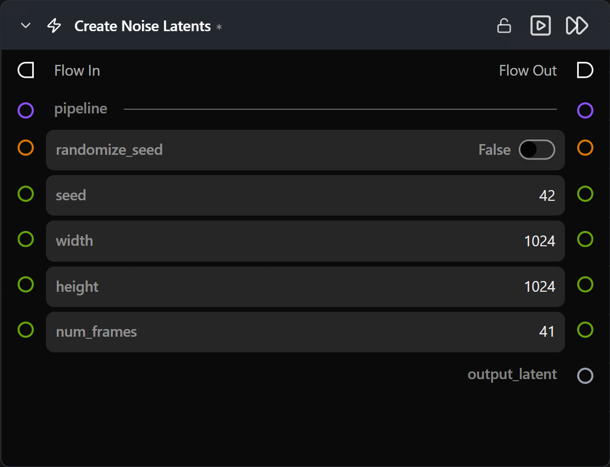

## When to use it

This node makes the random starting point that a model generates from. It is a [latent](../guides/what-is-a-latent.md) full of noise, sized to fit the connected pipeline. A latent is the compressed form of a picture or clip that the model works on. The model cleans the noise up into a picture or clip.

Use it when you are generating from a prompt alone and want to control the size and the seed. The seed is a number that fixes the random pattern. The same seed, pipeline and size give the same noise every time, so you can repeat a result or vary only the prompt.

To start from an existing picture or clip, use [Encode Media](VaeEncodeNode.md). For an all-zero latent, use [Create Empty Latent](EmptyLatentNode.md).

## Where it fits

```text
Build Pipeline → [Create Noise Latent] → Generate Latent → Decode Media
```

## What it needs

- A pipeline from [Build Pipeline](LatentDiffusionPipelineBuilderNode.md). It decides the latent shape and whether `num_frames` is shown.
- Width, height and frame count that suit the model (see below). By default a value that does not fit stops the run with a message that gives a suggested value, which is normally the next valid size up.
- To fix such values automatically with a warning, turn on **Auto Resize** under Library Settings > Diffusion Library.



## Parameters

### pipeline

The pipeline from Build Pipeline. Required: the run stops with a message if it is not connected. It sets the latent shape and whether `num_frames` is shown.

### width

Width in pixels. The node converts it to the model's latent size. Default 1024.

### height

Height in pixels. Default 1024.

### num_frames

Number of video frames. It is shown only when the connected pipeline makes video. Default 41. Video models need `num_frames - 1` to divide evenly by the model's temporal compression, so values such as 81 work and 80 does not.

### seed

The random seed. Default 42. The seed only gives the same noise within one pipeline type, because each model has its own latent shape.

### randomize_seed

Picks a new `seed` on every run. While it is on, `seed` is read-only. Default off.

### output_latent

The noise latent. Connect it to Generate Latent.

## What changes by pipeline

- **Most image models.** Width and height must be multiples of the model's size step, which is 8 or 16 depending on the model. Flux3 needs multiples of 16.
- **Flux2 Klein and Flux2 Dev.** Sizes must be multiples of 32 and the picture cannot be larger than 1024x1024 in area. Larger sizes are scaled down and rounded down, so the suggested value is smaller than what you typed.
- **Qwen Image 2.1 and Qwen Image 2.1 Turbo.** Width and height must be multiples of 32. The model was trained on seven sizes: 2048x2048 (1:1), 2400x1792 (4:3), 1792x2400 (3:4), 2528x1696 (3:2), 1696x2528 (2:3), 2752x1536 (16:9) and 1536x2752 (9:16). Any other multiple of 32 still runs. The node shows a warning that names the closest listed size, and quality may drop.
- **Qwen Edit.** Only sizes of about one megapixel (1024x1024 in area) at your aspect ratio are accepted. Any other size gets a suggested value with that area.
- **HunyuanVideo 1.5 Image-to-Video.** Width and height are resized to the sizes the model supports. Frame count follows the usual rule.
- **WAN Animate 2.** This node sets the size and length of the result. Generate Latent has no size settings, and it stretches the character image and every driving-video frame to this `width` by `height`, so match the character image's aspect ratio. Width and height must be multiples of 16, and `num_frames` must be 4N + 1, such as 81. The driving video needs at least `num_frames` frames at 24 fps. Clips longer than the segment length (`segment_frame_length`, default 81) run as overlapping segments.
- **MiniMax-H3.** This node sets the size and length, and the defaults do not work. Use a 768-pixel short edge, such as 1344x768 for 16:9, or 960x544. Width and height must be multiples of 32, the area at most 1,032,192 pixels, and the aspect ratio between 1:4 and 4:1. `num_frames` must be between 124 and 345 and fit the form 17 x n + 5. That is 5 to 15 seconds at 24 fps. The latent also carries the noise for the soundtrack that is generated with the video.

## Tips

- Width, height and frame count must be a non-zero positive whole number. Zero or negative values stop the run with a message.
