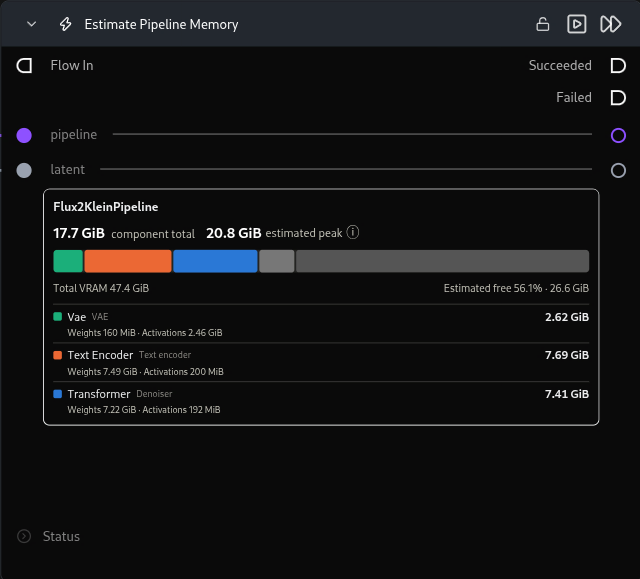

## When to use it

This node estimates how much GPU memory a model needs, so you can check before a long run.

You have a pipeline, which is the model loaded or not, and a [latent](../guides/what-is-a-latent.md) at the size you plan to generate. The node splits the estimate into weights and working memory for each part of the model, such as [text encoders](../guides/what-is-a-text-encoder.md), the [transformer](../guides/what-is-a-transformer.md) or UNet, and the [VAE](../guides/what-is-a-vae.md). It also shows an estimated peak.

## Where it fits

```text
Build Pipeline → Encode Media → [Estimate Pipeline Memory]
```

## What it needs

- A pipeline from [Build Pipeline](LatentDiffusionPipelineBuilderNode.md).
- A latent at the size you will generate with, from [Create Noise Latent](NoiseLatentNode.md), [Encode Media](VaeEncodeNode.md) or similar. Its shape sets the working-memory estimate. Without a pipeline or a latent the node reports a failed status with a message and shows no estimate.



## Parameters

### pipeline

The pipeline to measure.

### latent

Shown as `input_latent`. Its shape gives the token count and resolution used for the working-memory estimate of the denoiser and the VAE.

### memory_breakdown

A read-only bar and list inside the node. It shows each part's weights, working memory and total. The estimated peak is shown separately. The peak accounts for CPU offload, for steps that do not overlap in time, and for 20% of safety headroom. Weights come from the loaded model when it is already loaded, and from the model's configuration when it is not, and in both cases reflect the chosen precision and quantization. Working memory is calculated from the latent's shape.

The node shows a warning for any part where only weights could be estimated. This happens for a component the estimator does not recognize, or a model config that cannot be read.

### was_successful

True when the estimate finished without an error.

### result_details

A summary line with the estimated peak and the number of parts.

## What changes by setup

- **Offload and VAE settings.** The peak reflects the CPU offload the pipeline is actually using. VAE working memory reflects whether VAE tiling or slicing is on.
- **Runtime LoRA.** When the pipeline comes from [Apply Runtime LoRA](LoraActivationPipelineNode.md), each distinct adapter file is counted once and added to the transformer or UNet weights. The transformer's hover text gives the LoRA share. There is no separate LoRA row, and LoRA working memory is not estimated.
- **ControlNet.** When the pipeline comes from [Apply ControlNet](ControlNetDiffusionPipelineBuilderNode.md), a single ControlNet is listed as `controlnet`, and stacked ones as `controlnet_0`, `controlnet_1` and so on. When the pipeline type has no ControlNet support registered, even a single ControlNet is listed as `controlnet_0`, with 0 weights and a warning. Weights grow with the number of ControlNets, and each one is read from its own repo. Its working memory is an approximation, marked as estimated. For SD and SDXL ControlNets it errs high. An estimate taken before the first generate shows 0 for weights and working memory on a ControlNet whose settings file is not cached, with a warning. The peak leaves that ControlNet out, so it may under-report. Once the pipeline is built, a ControlNet whose config cannot be read shows weights only, with a warning.
- **WAN Animate 2.** The transformer figure sizes the whole clip instead of one segment and leaves out the reference cache kept for each transformer layer. Real use is likely much higher than shown, and the node shows a warning.

## Tips

- Treat the number as a guide. It is calculated, not measured on the GPU, and usually leans high. WAN Animate 2 is the exception.
- The fixed memory a GPU reserves when CUDA starts is not included. Tools that report total GPU use show it.
- Caching in PyTorch's memory allocator is not modeled. With several pipelines loaded at once, the gap between the estimate and real use tends to grow, because each pipeline is estimated on its own.

## See also

- [Build Pipeline](LatentDiffusionPipelineBuilderNode.md)
- [Generate Latent](DiffusionPipelineGenerateLatentNode.md)
- [Clear Pipeline Cache](ClearPipelineCacheNode.md)
