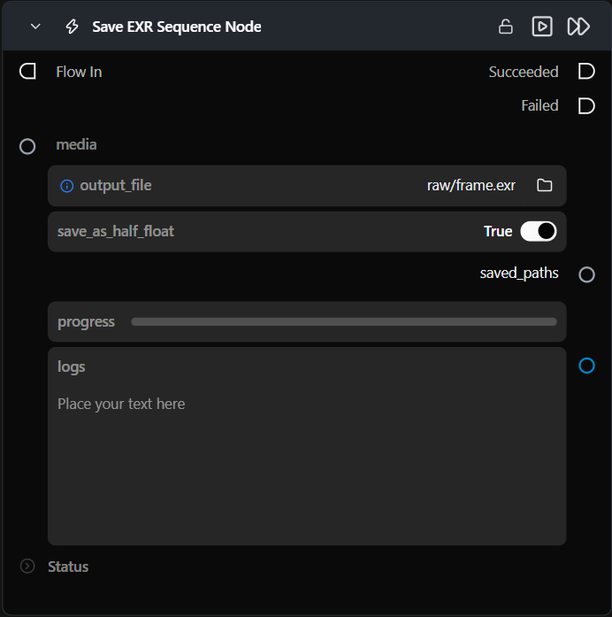

## When to use it

You have float RGB frames from [Decode HDR Media](DecodeHdrNode.md) and want an EXR sequence you can load into a comp. The node writes the float values exactly as they arrive. It does not convert color space, so prepare the values before saving if you need that.

## Where it fits

```text
Generate Latent → Decode HDR Media → [Save EXR Sequence]
```

## What it needs

- Float media from Decode HDR Media, connected to `media`. Anything else stops the run with a message.
- Decode HDR Media and this node in the same run. The float media is not stored in a saved workflow.



## Parameters

### media

The float RGB image or video frames to write.

### output_file

The name and place of the sequence. The default is `videos/sequence.exr`. The file name without its extension is the sequence name, and the extension is ignored. So `shot.exr` writes `shot_v001/shot.0001.exr`, `shot_v001/shot.0002.exr` and so on.

A folder in the name, such as `renders/shot.exr`, writes into that subfolder of the project outputs folder. An absolute path writes into that folder. Do not add a frame number, because the node adds it, and the node always writes `.exr` files. The name must include a file name, or the run stops with a message.

### save_as_half_float

On by default, which writes 16-bit float channels and smaller files. Turn it off to write 32-bit float channels.

### saved_paths

The paths of the written frames, in order.

### logs

The path and size of each frame as it is written.

## Tips

- Each run writes to the next free version folder (`_v001`, `_v002`, ...), so a re-run never overwrites an earlier sequence.
- In-project folders chosen with the picker are stored as project macros, so the path stays portable.
- If a run fails, frames written before the error stay on disk. Check the folder before re-running.

## See also

[Decode HDR Media](DecodeHdrNode.md)
