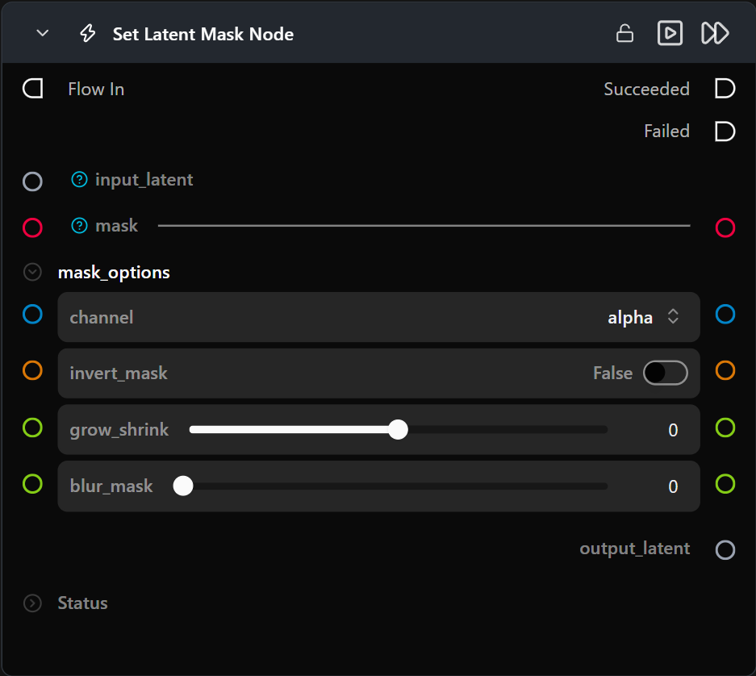

## When to use it

You have an encoded image and a mask that marks what to change. White is redone, black is kept, and gray is redone partially. Connect `output_latent` to [Generate Latent](DiffusionPipelineGenerateLatentNode.md) with `add_noise` on. Only the masked areas are regenerated. This is differential diffusion, and it does not switch the model to a separate inpaint pipeline.

## Where it fits

```text
Encode Media ─────────┐
                      ├─→ [Set Latent Mask] ──→ Generate Latent (add_noise on) → Decode Media
Paint Mask ───────────┘
```

## What it needs

- A 4-D image latent or a 5-D video latent from [Encode Media](VaeEncodeNode.md). Anything else stops the run with a message. None of the video pipelines in this library support masked denoising, so in practice this is for images.
- A mask image. Without one the run stops with a message.
- A pipeline that supports masked denoising: Flux.1 (including Kontext), Flux2, Flux3, Qwen-Image, Qwen-Image-Edit, Stable Diffusion 3, SDXL and Z-Image. Flux Fill and the video models do not.
- A scheduler of order 1 on the pipeline. Other schedulers stop the run with a message.
- The latent connected to Generate Latent must have the same size as the one you gave this node.



## Parameters

### input_latent

The latent to repaint. If it is a video latent, the same mask applies to every frame.

### mask_image

The mask. White is fully selected, black is not selected, and gray is partial. The mask is resized to the latent size when the latent is prepared.

### channel

The channel of the mask image to read: `red` (default), `green`, `blue` or `alpha`. A grayscale image is used as it is. `alpha` on an image with no alpha channel reads the red channel instead.

### invert_mask

Swaps selected and unselected areas. Off by default.

### grow_shrink

Changes the mask size in pixels, from -100 to 100. Positive values shrink the mask. Negative values grow it. Default 0.

### blur_mask

Softens the mask edge, from 0 to 100. Default 0.

The options apply in this order: grow or shrink, then invert, then blur.

### output_mask

The mask after the channel, grow or shrink, invert and blur options. It updates on every run, so you can check what the model will use.

### output_latent

The input latent together with the processed mask. It is kept in the running session and cannot be saved with the workflow. Connect it to Generate Latent.

## Tips

- On Generate Latent, turn `add_noise` on. Without it, denoising starts from the clean source image instead of from noise.
- Paint white where you want a change. Gray gives a partial change.
