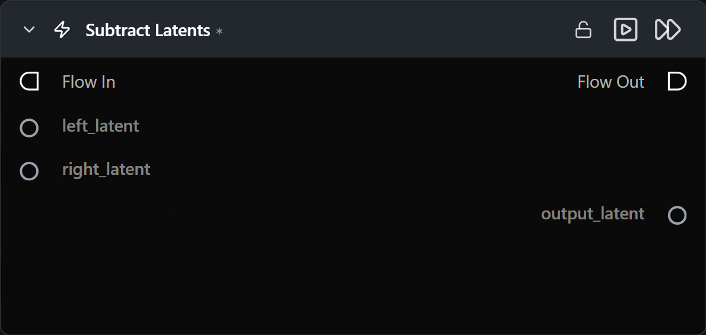

## When to use it

You have two latents of the same shape and want the difference. Typical uses are isolating noise (denoised minus noisy) and comparing two results in latent space. Both latents should come from the same kind of model so their shapes match.

## Where it fits

```text
Latent A ─┐
          ├─→ [Subtract Latents] → Generate Latent
Latent B ─┘
```



## Parameters

### left_latent

The latent to subtract from. The result keeps its source shape and its metadata takes priority over the right latent's.

### right_latent

The latent to subtract. It must have the same shape as `left_latent`. If the shapes differ, the run stops with a message that lists both shapes. Resize or upsample one first.

### output_latent

`left_latent` minus `right_latent`, value by value.

## Tips

- Order matters. A minus B is not the same as B minus A.

## See also

[Add Latents](AddLatentsNode.md) · [Multiply Latents](MultiplyLatentsNode.md)
