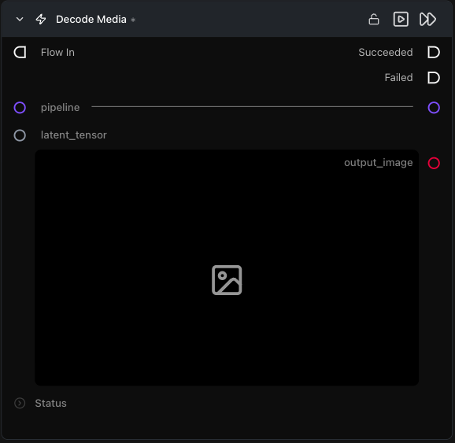

## When to use it

This node turns the model's result back into something you can look at. The model works on a [latent](../guides/what-is-a-latent.md), the compressed form of a picture or clip. The [VAE](../guides/what-is-a-vae.md) is the part of the model that converts between pictures and latents, and here it decodes the latent into a picture or clip.

You have a latent from [Generate Latent](DiffusionPipelineGenerateLatentNode.md) and want the picture or the clip. Connect the result to a Save Image or Save Video node. The output changes with the pipeline. Image models give an image, video models give a video.

For a standalone decode that needs no pipeline, see [Convert Latent to Media](LatentToMediaNode.md). For float HDR frames, see [Decode HDR Media](DecodeHdrNode.md).

## Where it fits

```text
Generate Latent → [Decode Media] → Save Image / Save Video
```

## What it needs

- The pipeline that made the latent. Each pipeline decodes with its own [VAE](../guides/what-is-a-vae.md).
- A latent that carries its picture size, which every latent made by the nodes in this library does. A missing latent, or one without a size, stops the run with a message.
- Enough memory for large latents. High resolutions and long clips need more. Turn on `vae_tiling` on Build Pipeline to lower the peak.



## Parameters

### pipeline

The pipeline that produced the latent. Required. Connecting it swaps the output to an image or a video.

### latent_tensor

Shown as `input_latent`. The latent to decode.

### fps

Shown only for video pipelines. The output frame rate. The field is limited to 1 to 120, and a value of 0 or less stops the run with a message. When the node switches from image to video, it starts at the rate the model generates at, so leaving it alone plays at the right speed. If you then swap one video pipeline for another, the value you have stays, so check it.

| Model | Default fps |
|-------|-------------|
| LTX | 25 |
| LTX2 | 24 |
| MiniMax-H3, MiniMax-H3 ref2va | 24 |
| WAN Animate 2 | 24 |
| HunyuanVideo 1.5 Image-to-Video | 24 |
| HunyuanVideo 1.5 text-to-video | 15 |
| Other WAN models (text-to-video, image-to-video, VACE, Animate) | 16 |

### output_image

The decoded image, for image pipelines.

### output_video

The decoded video as an MP4, for video pipelines.

## What changes by model

- **LTX2 and MiniMax-H3** give an MP4 with a sound track when the latent carries the generated sound. The sound is generated together with the picture and joined here. When there is a sound track, the node always encodes at the model's own frame rate, even if you set `fps` to something else, because another rate would put sound and picture out of step. A latent without the sound gives a silent video at `fps`. LTX2's HDR path does not make audio.
- **LTX, WAN and HunyuanVideo 1.5** give a silent MP4 at `fps`.
- **WAN Animate 2.** Long clips are generated in segments, and the node uses the stored segment information to rebuild the clip with its original overlaps. If that information is missing, it decodes in a single pass. This happens with a fresh Create Empty Latent output or a cancelled run. The frame count stays the same, but frames near the segment joins can differ. Live previews during generation also have no segment information and can differ from the final result.
- **Qwen Image 2.1 and Qwen Image 2.1 Turbo** give an RGBA image. The alpha channel, which holds transparency, is kept through decoding and in the saved image.
- **Flux3** gives an image. The node unpacks the model's VAE patches, and applies the crop recorded when the latent was encoded from a reference image.

## Tips

- The sound track travels with the latent as extra information. Create Empty Latent and Save Latent do not keep it, so a latent made that way decodes to a silent video.
- Add, Subtract and Multiply Latents change the picture but keep the old sound track. The decoded video then plays the original sound with the edited picture.

## See also

- [Encode Media](VaeEncodeNode.md) is the reverse step.
- [Generate Latent](DiffusionPipelineGenerateLatentNode.md) is the usual node before this one.
