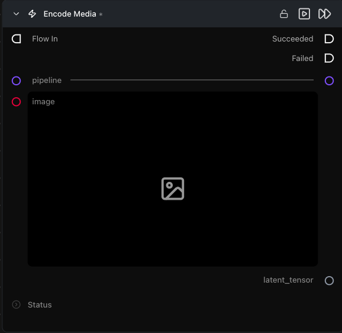

## When to use it

You have a picture or a clip and want the model to rework it instead of starting from noise. Encode it here, then connect the latent to [Generate Latent](DiffusionPipelineGenerateLatentNode.md) with `add_noise` on. The input changes with the pipeline: image models take an image, video models take a video.

To start from nothing, use [Create Noise Latent](NoiseLatentNode.md). To repaint only part of a frame, use [Encode Masked Media](VaeMaskEncodeNode.md).

## Where it fits

```text
Load Image → [Encode Media] → Generate Latent → Decode Media
```

## What it needs

- A pipeline. Required. It decides whether the node takes an image or a video. When the pipeline type changes between image and video, the input is replaced, so reconnect your media.
- The media itself. Without it the run stops with a message.
- A size the model accepts. Most models need width and height in multiples of 8 or 16. Video models also need `frames - 1` to divide evenly by the model's temporal compression. By default a media size that does not fit stops the run with a message that gives suggested values. Turn on **Auto Resize** under Library Settings > Diffusion Library to resize images and videos to the suggested width and height automatically, with a warning in the log. Auto Resize does not change a video's frame count, except for MiniMax-H3 (see below), so trim the clip to a valid length yourself.



## Example

To restyle a plate while keeping its layout:

1. Load the plate and connect it to `image`.
1. Run Encode Media, then Generate Latent with `add_noise` on.
1. Choose `start_step` on Generate Latent to set how much of the plate survives. With 20 steps, `start_step` 0 ignores the plate, 10 blends it half and half, and 18 stays very close to it.

The strength is 1 minus `start_step` divided by `num_inference_steps`, which is the share of the steps that run.

## Parameters

### pipeline

The pipeline whose VAE does the encoding.

### image

For image pipelines. The source image.

### input_video

For video pipelines. The source video.

### latent_tensor

Shown as `output_latent`. The encoded latent, normalized and unpacked, so the latent math and composite nodes work on it directly. It has the same layout as the output of Create Noise Latent for the same pipeline.

## What changes by model

- **WAN Animate 2.** Video only. The video becomes a latent. Width and height must be multiples of 16 and the frame count must be 4N + 1. Auto Resize fixes width and height only, so trim the clip to 4N + 1 frames yourself. An image stops the run with a message, because the character image is not encoded. Connect it to `image` on Generate Latent. The latent cannot be re-noised for Video-to-Video, because WAN Animate 2 does not support `add_noise`.
- **MiniMax-H3.** Video only. The video becomes a video latent, and its sound track becomes an audio latent carried with it. The clip is treated as 24 fps and must be 124 to 345 frames long in the form 17 x n + 5. Outside that, the run stops unless **Auto Resize** is on. With Auto Resize on, a shorter clip is padded by repeating its last frame, and a longer one is cut at the limit. A clip with no sound can start at step 0 and gets a new sound track. A later `start_step` needs the sound track.
- **Flux3.** Image only. The latent carries crop information so Decode Media can restore the image's bounds.
- **Other video models.** If the clip's frame rate differs from the model's, the frames are encoded as they are, without resampling, and a warning is logged.

## See also

- [Encode Masked Media](VaeMaskEncodeNode.md) is the inpainting variant.
- [Decode Media](VaeDecodeNode.md) is the reverse step.
