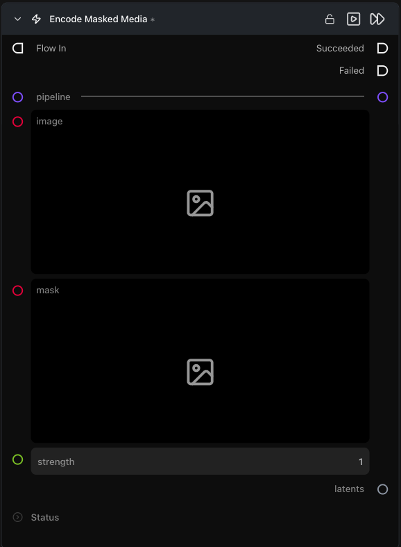

## When to use it

You have an image and a mask that marks the area to regenerate. Connect the result to `input_latent` on [Generate Latent](DiffusionPipelineGenerateLatentNode.md). It sees the inpainting package and runs the model's inpainting mode by itself, so only the masked area changes.

For soft, graded edits, use [Set Latent Mask](SetLatentMaskNode.md). To encode an image with no mask, use [Encode Media](VaeEncodeNode.md).

## Where it fits

```text
Load Image ──┐
             ├─→ [Encode Masked Media] → Generate Latent → Decode
Paint Mask ──┘
```

## What it needs

- A pipeline that supports inpainting: Flux, Flux Fill, Flux Kontext, Flux2 Klein, Qwen Image, Qwen Image Edit, Stable Diffusion 3, SDXL and Z-Image. Any other pipeline stops the run with a message. Choose Flux Fill in the model picker on Build Pipeline for a dedicated inpainting model.
- A pipeline, an image and a mask. All three are required, and a missing one stops the run with a message.
- An image size the model accepts, usually a multiple of 8 or 16. By default a size that does not fit stops the run with a message that gives suggested values. Turn on **Auto Resize** under Library Settings > Diffusion Library to resize the image and mask automatically.



## Parameters

### pipeline

The pipeline whose VAE does the encoding.

### image

The source image.

### mask

White marks the area to regenerate and black marks the area to keep. Gray is rounded: 50% and above is regenerated, below is kept. The mask is converted to grayscale and resized to the image for you, so the two need not match in size. A color mask is read by brightness, and any alpha channel is ignored.

### strength

How strongly the masked area is replaced, from 0.0 to 1.0. The default is 0.95. A value of 1.0 fully replaces it, and lower values blend with the original. A value of 0 is read as 1.0. The strength is stored in the package, so change it here and not on Generate Latent.

### latents

Shown as `output_latent`. The package holding the mask, the encoded source and masked images, and the strength. Connect it to Generate Latent, not to a decode node. It is kept in the running session and cannot be saved with the workflow.

## See also

- [Encode Media](VaeEncodeNode.md) is the version without a mask.
- [Generate Latent](DiffusionPipelineGenerateLatentNode.md) detects the inpainting package.
