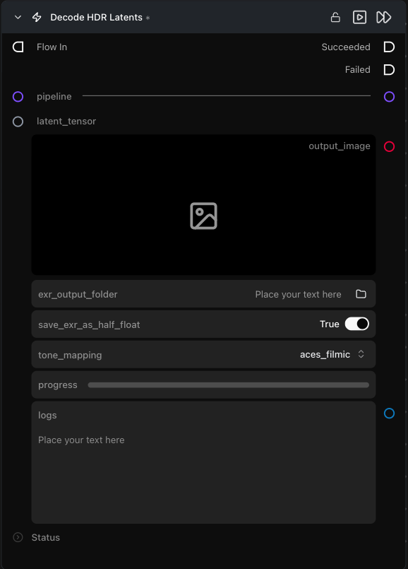

# Decode HDR Latents

**Decodes a latent to float RGB media, exposes the unmodified frames, and publishes a tone-mapped SDR preview.**

Category: `ModularDiffusion/Encode\Decode`

## TL;DR
- Extends [Decode Media Latent](decode_media_latent.md): same inputs and dynamic image/video preview, plus a `raw_media` float output for downstream processing or EXR export.
- Output includes decoder-provided float RGB data and an image or MP4 preview. Connect `raw_media` to [Save EXR Sequence](save_exr_sequence.md) to write the values unchanged to OpenEXR frames.
- The image or video preview is tone-mapped by default; choose `None` to skip tone mapping and clip values for display. Video previews retain audio when the selected driver produces it.
- `raw_media` contains unmodified floating-point RGB returned by the decoder's NumPy path. Its range and color-space interpretation depend on the model pipeline and are not standardized by this library.

## Typical workflow position
```text
Generate Media Latents → [Decode HDR Latents] ──→ SDR Preview
                              └────────────────→ [Save EXR Sequence]
```

## Node preview



## Inputs

| Name | Type | Required | Notes |
| --- | --- | --- | --- |
| `pipeline` | `Pipeline Config` | Yes | Must match the pipeline that produced the latent; output interpretation depends on that model pipeline. |
| `latent_tensor` | `LatentArtifact` | Yes | Latent to decode. |

## Outputs

| Name | Type | Notes |
| --- | --- | --- |
| `raw_media` | `FloatMediaArtifact` | Decoder's floating-point NumPy RGB output, unchanged by this node; connect to Save EXR Sequence. |
| `output_image` | `ImageUrlArtifact` | Image preview; tone mapping is applied unless `tone_mapping` is `None`. |
| `output_video` | `VideoUrlArtifact` | MP4 preview; tone mapping is applied unless `tone_mapping` is `None`. |

## Parameters

| Name | Type | Default | Notes |
| --- | --- | --- | --- |
| `tone_mapping` | `None \| clip \| reinhard \| aces_filmic \| cv2_reinhard \| cv2_mantiuk` | `aces_filmic` | `None` skips tone mapping and clips decoder values to `[0, 1]` for preview; other operators assume linear input, which may not match the model pipeline. |
| `fps` | int (1–120) | `25` | Output frame rate. Only shown for video pipelines. |

## Tips & pitfalls

- **Connect `raw_media` to Save EXR Sequence for file output.** The saver writes values unchanged; choose or perform any required conversion upstream.
- **Treat `raw_media` as in-process data.** `FloatMediaArtifact` is intentionally not serialized with workflow state; run the decoder and saver in the same execution.
- **Treat tone-mapped previews as an assumption.** The operators other than `None` assume linear input; whether decoded values are linear depends on the selected model pipeline, and the library does not detect it.
- **Use the same pipeline that produced the latent.** Each pipeline carries the VAE it was trained with — decoding with a mismatched VAE produces corrupt output.
- **Large latents need more VRAM to decode.** High-resolution or multi-frame latents require more memory during decode. Enable `vae_slicing` on the Pipeline Builder to decode in batches and keep peak VRAM usage lower.

## See also

- [Decode Media Latent](decode_media_latent.md) — base node; use for non-HDR pipelines.
- [Generate Media Latents](generate_media_latents.md) — typical upstream node.
- [Save EXR Sequence](save_exr_sequence.md) — writes decoded float frames as OpenEXR.
