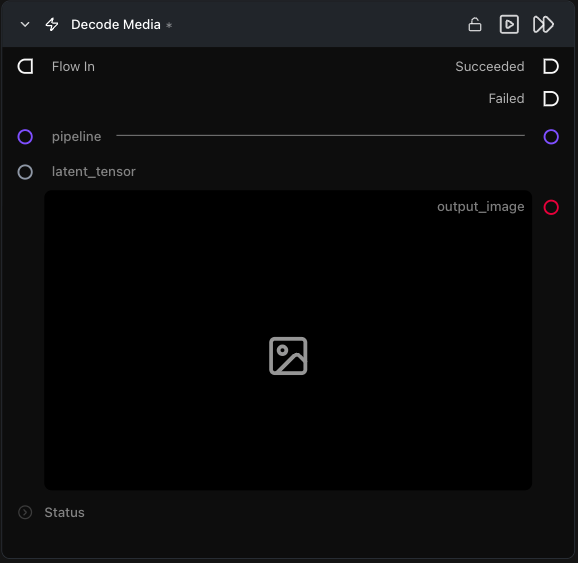

# Decode Media

**Runs the pipeline's VAE decoder on a latent, producing an image or video — typically the final node in a flow.**

Category: `ModularDiffusion/Encode & Decode`

## TL;DR
- Output is **dynamic**: `output_image` for image pipelines, `output_video` (+ `fps`) for video pipelines (LTX, LTX2, WAN, HunyuanVideo 1.5, MiniMax-H3). It swaps automatically when you connect a `pipeline`.
- Almost always the last node in the flow. Connect to a Save Image / Save Video node downstream.
- **MiniMax-H3 and LTX2 videos come out with sound.** The soundtrack is generated jointly with the picture, travels with the latent's metadata, and is muxed into the same MP4 here. LTX2's HDR IC-LoRA path does not produce audio.

## Typical workflow position
```text
Generate Latent → [Decode Media] → Save Image / Save Video
```

## Node preview



## Inputs

| Name | Type | Required | Notes |
| --- | --- | --- | --- |
| `pipeline` | `Pipeline Config` | Yes | Must match the pipeline that produced the latent. |
| `latent_tensor` | `LatentArtifact` | Yes | Latent to decode. |

## Outputs

| Name | Type | Notes |
| --- | --- | --- |
| `output_image` | `ImageUrlArtifact` | For image pipelines. |
| `output_video` | `VideoUrlArtifact` | For video pipelines. |

## Parameters

| Name | Type | Default | Notes |
| --- | --- | --- | --- |
| `fps` | int (1–120) | model's native rate | Output frame rate. **Only shown for video pipelines.** Defaults to the rate the selected model generates at (LTX 25, MiniMax-H3 24, WAN Animate 2 24, WAN 16, HunyuanVideo 1.5 15), so leaving it alone plays back at the correct speed. |

## Provider / model behavior

| Provider | Behavior |
| --- | --- |
| Image pipelines | `output_image` as an `ImageUrlArtifact`. |
| LTX, WAN, HunyuanVideo 1.5 | `output_video` as a silent MP4 at `fps`. |
| WAN Animate 2 (and Distilled) | `output_video` as a silent MP4 at `fps` (default **24**). A latent straight from [Generate Latent](generate_media_latents.md) carries per-segment metadata, so long clips decode exactly as they were generated. Without that metadata (after Save/Load Latent Tensor, Create Empty Latent, a cancelled run, or in the live preview) the latent decodes as one plain WAN video: the frame count is the same, but frames near each segment seam can differ slightly. |
| LTX2 (base, video-conditioning, IC-LoRA) | `output_video` as an MP4 **with an audio track**. Video and audio are generated jointly by one denoising loop, and are muxed together here. The HDR IC-LoRA path (`Decode HDR Media`) never produces audio. |
| MiniMax-H3 | `output_video` as an MP4 **with an audio track**. Video and audio are generated jointly by one denoising loop, and are muxed together here. `fps` defaults to the model's fixed **24** — changing it desynchronises the soundtrack, since the audio is muxed at its own true sample rate. |
| Flux3 | `output_image` as an `ImageUrlArtifact`. The decoder restores the model's packed VAE patches internally and crops VAE-encoded single-image latents back to their reference bounds. |

### MiniMax-H3 and LTX2: audio metadata

Both models' audio latent travels in the latent's *metadata*, not in its tensor:

- **Empty Latents, Save Latent, Load Latent Tensor** drop the audio metadata. Decoding still works and
  produces a silent video, with a debug-level log message.
- **Add / Subtract / Multiply Latents, Composite Latents with Mask, Upsample Latent** are worse: they
  change the video latent while retaining its existing audio metadata. Decoding muxes that retained
  soundtrack with the edited video.

## Tips & pitfalls

- **Use the same pipeline that produced the latent.** Each pipeline carries the VAE it was trained with — decoding a latent with a mismatched VAE produces corrupt output.
- **Large latents need more VRAM to decode.** High-resolution and multi-frame latents require more memory. In the Build Pipeline node, turn on `vae_slicing` to decode in batches and reduce peak VRAM usage.

## See also

- [Encode Media](encode_media_latent.md) — inverse operation.
- [Generate Latent](generate_media_latents.md) — typical upstream node.
- [Convert Latent to Media](latent_to_media.md) — standalone alternative that needs no pipeline, for models both nodes support.
