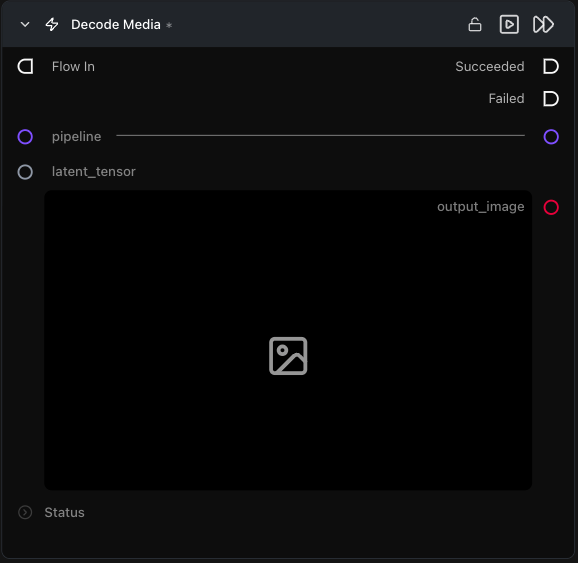

# Decode Media

**Runs the pipeline's VAE decoder on a latent, producing an image or video — typically the final node in a flow.**

Category: `Diffusion/Encode & Decode`

## TL;DR
- Output is **dynamic**: `output_image` for image pipelines, `output_video` (+ `fps`) for video pipelines (LTX, LTX2, WAN, HunyuanVideo 1.5, MiniMax-H3). It swaps automatically when you connect a `pipeline`.
- Almost always the last node in the flow. Connect to a Save Image / Save Video node downstream.
- **MiniMax-H3 and LTX2 videos come out with sound.** The soundtrack is generated jointly with the picture, travels with the latent's metadata, and is muxed into the same MP4 here. LTX2's HDR IC-LoRA path does not produce audio.

## Typical workflow position
```text
Generate Latent → [Decode Media] → Save Image / Save Video
```

## Node preview



## Inputs

| Name | Type | Required | Notes |
| --- | --- | --- | --- |
| `pipeline` | `Pipeline Config` | Yes | Must match the pipeline that produced the latent. |
| `latent_tensor` | `LatentArtifact` | Yes | Latent to decode. |

## Outputs

| Name | Type | Notes |
| --- | --- | --- |
| `output_image` | `ImageUrlArtifact` | For image pipelines. |
| `output_video` | `VideoUrlArtifact` | For video pipelines. |

## Parameters

| Name | Type | Default | Notes |
| --- | --- | --- | --- |
| `fps` | int (1–120) | model's native rate | Output frame rate. **Only shown for video pipelines.** Defaults to the rate the selected model generates at (LTX 25, MiniMax-H3 24, WAN Animate 2 24, WAN 16, HunyuanVideo 1.5 15), so leaving it alone plays back at the correct speed. |

## Provider / model behavior

| Provider | Behavior |
| --- | --- |
| Image pipelines | `output_image` as an `ImageUrlArtifact`. |
| LTX, WAN, HunyuanVideo 1.5 | `output_video` as a silent MP4 at `fps`. |
| WAN Animate 2 (and Distilled) | `output_video` as a silent MP4 at `fps` (default **24**). For multi-segment generations, [Generate Latent](generate_media_latents.md) stores per-segment metadata that Decode Media uses to reconstruct the clip with the original segment boundaries and overlaps. If that metadata is missing or incomplete—for example, when decoding an untouched Create Empty Latent output, after saving and reloading a latent tensor, or when a canceled run leaves segments unrecorded—Decode Media falls back to a single-pass WAN decode. The output keeps the requested frame count, but frames near segment boundaries may differ from the segmented result. Live previews decode only the current segment and may therefore differ from the final output. |
| LTX2 (base, video-conditioning, IC-LoRA) | `output_video` as an MP4 **with an audio track**. Video and audio are generated jointly by one denoising loop, and are muxed together here. The HDR IC-LoRA path (`Decode HDR Media`) never produces audio. |
| MiniMax-H3 | `output_video` as an MP4 **with an audio track**. Video and audio are generated jointly by one denoising loop, and are muxed together here. `fps` defaults to the model's fixed **24** — changing it desynchronizes the soundtrack, since the audio is muxed at its own true sample rate. |
| Flux3 | `output_image` as an `ImageUrlArtifact`. The decoder restores the model's packed VAE patches internally and crops VAE-encoded single-image latents back to their reference bounds. |

### MiniMax-H3 and LTX2: audio metadata

The audio latent for both models is carried in the latent's *metadata*, not in its tensor:

- **Create Empty Latent and Save Latent** drop the audio metadata, as do latents reloaded from a saved `.pt` file. Decoding still works and
  produces a silent video, with a debug-level log message.
- **Add / Subtract / Multiply Latents, Composite Latents with Mask, Upsample Latent** are worse: they
  change the video latent while retaining its existing audio metadata. Decoding muxes that retained
  soundtrack with the edited video.

## Tips & pitfalls

- **Use the same pipeline that produced the latent.** Each pipeline carries the VAE it was trained with — decoding a latent with a mismatched VAE produces corrupt output.
- **Large latents need more VRAM to decode.** High-resolution and multi-frame latents require more memory. Enable `vae_tiling` on Build Pipeline to reduce peak VRAM usage.

## See also

- [Encode Media](encode_media_latent.md) — inverse operation.
- [Generate Latent](generate_media_latents.md) — typical upstream node.
- [Convert Latent to Media](latent_to_media.md) — standalone alternative that needs no pipeline, for models both nodes support.
