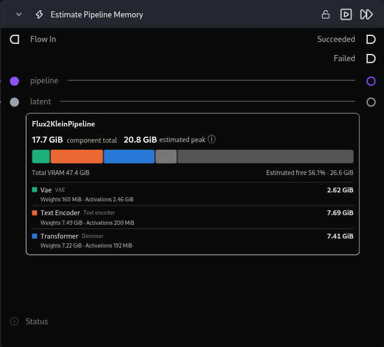

# Estimate Pipeline Memory

**Estimates per-component GPU memory usage for a loaded diffusion pipeline.**

Category: `ModularDiffusion/Pipeline`

## TL;DR
- Breaks down memory into weights and activations for each resident component (text encoders, transformer/UNet, VAE).
- Uses the latent's shape to calculate the denoiser's and VAE's activation-memory estimate, so it must be wired to a real latent.
- Reads weight sizes from the loaded pipeline's tensors and offload topology from its live hooks, so weight figures reflect the pipeline's actual dtype and quantization.
- Activation memory is modeled analytically from the latent's shape. Estimates are biased to overestimate and are approximations.
- Folds unfused LoRA adapter weights from a connected LoRA Pipeline into the transformer/UNet estimate; the widget does not add a separate LoRA component row.

## Typical workflow position

```text
Pipeline Builder → Generate Media Latents → [Estimate Pipeline Memory]
```

## Node preview



## Inputs

| Name | Type | Required | Notes |
| --- | --- | --- | --- |
| `pipeline` | `Pipeline Config` | Yes | Connect from Pipeline Builder. |
| `latent` | `LatentArtifact` | Yes | Determines the token count / resolution used in the activation-memory estimate. |

## Outputs

| Name | Type | Notes |
| --- | --- | --- |
| `memory_breakdown` | `dict` | Read-only visual breakdown of component totals, weights, activations, warnings, and the separate estimated peak value. |
| `was_successful` | `bool` | `True` when the estimate completed without exception. |
| `result_details` | `str` | Summary line with the estimated peak and component count. |

## Provider / model behavior

Denoiser activation memory is estimated using one of three architecture families: UNet-SDPA (SDXL), Image-DiT-SDPA (Flux, Flux2, SD3, Qwen, Z-Image, ...), or Video-DiT-joint-SDPA (LTX, LTX2, WAN, HunyuanVideo 1.5, MiniMax-H3). A pipeline class without a registered family, or a component whose config can't be read (e.g. a heavily fused/custom checkpoint), falls back to a weight-only estimate with a warning in the widget rather than failing.

**Unfused LoRA.** When the connected pipeline comes from a [LoRA Pipeline](lora_pipeline.md) node, each distinct runtime adapter file is counted once and its header-derived weight bytes are folded into the primary transformer/UNet estimate. The transformer hover text reports the total LoRA bytes as both a percentage of the base transformer weights and a percentage of the combined transformer-plus-LoRA weights. LoRA activation workspace is not separately modeled. The source-only CLI keeps the detailed adapter list in a separate `lora_adapters` section.

The `memory_breakdown` output renders the estimate as a segmented bar and a labeled component list inside the node. Segment widths use the sum of component totals; the estimated peak is shown separately because it applies offload topology, non-overlapping activation phases, and safety headroom. The widget remains read-only and reports loading, unavailable, and warning states without changing the estimate.

**ControlNet (Flux, SD3, SDXL, Qwen, Z-Image).** When the connected pipeline is wrapped by a [ControlNet Pipeline](controlnet_pipeline.md) node, each stacked ControlNet appears as its own `controlnet_0`, `controlnet_1`, … component — weight bytes scale ~linearly with stack size, since each is an independent weight set regardless of the multi-ControlNet wrapper class used under the hood. Weight bytes are read from each ControlNet's own config (its own repo, not the base pipeline's), so a ControlNet's shape is never assumed to match the base denoiser's. Activation bytes reuse the base architecture family's per-token formula against the ControlNet's own (usually smaller) layer count — an approximation, always flagged `[ESTIMATED: ...]`. On SDXL specifically, this reuses the full UNet-SDPA level formula against the real ControlNetModel's down-only architecture (no up-blocks), which overestimates on purpose per this node's bias-toward-overestimate stance. If a ControlNet's config can't be read, that ControlNet's entry falls back to weights-only with a warning.

Offload topology is detected from the loaded pipeline's live CPU-offload hooks, so the peak reflects the setup the pipeline is actually running with. VAE activation memory reflects whether `vae_tiling`/`vae_slicing` are configured.

**Tiled VAE tracing.** For supported tiled VAEs, the estimator traces encoder and decoder calls on meta tensors, then reuses those traces for matching tiles. Tile stitching and retained outputs are still counted. Large tile grids are estimated from smaller samples.

## API reference

This node is a thin wrapper — the estimate itself is a plain importable function, callable from any other node or script without going through the node at all.

```python
from modular_diffusion_nodes_library.memory_estimation.pipeline_memory_estimator import (
    estimate_pipeline_memory_from_artifact,
)

estimate = estimate_pipeline_memory_from_artifact(pipeline_artifact, latent_artifact)
```

Note the import path: `estimate_pipeline_memory_from_artifact` is exported from the `pipeline_memory_estimator` submodule, not from `modular_diffusion_nodes_library.memory_estimation`'s top-level `__init__.py` (which only re-exports `estimate_pipeline_memory` and `estimate_component_memory`).

### `estimate_pipeline_memory_from_artifact(artifact, latent) -> PipelineMemoryEstimate`

| Parameter | Type | Notes |
| --- | --- | --- |
| `artifact` | `DiffusionPipelineArtifact` | Same object as this node's `pipeline` input. |
| `latent` | `LatentArtifact` | Same object as this node's `latent` input. |

`PipelineMemoryEstimate` fields:

| Field | Type | Notes |
| --- | --- | --- |
| `pipeline_name` | `str` | |
| `offload_mode` | `str \| None` | `"model"`, `"sequential"`, or `None`. |
| `estimated_peak_bytes` | `int` | Estimated peak memory after the estimator's 20% safety-headroom factor; the node displays the value with the applied optimization settings. |
| `components` | `list[ComponentMemoryEstimate]` | One entry per weight-bearing component. |
| `warnings` | `list[str]` | Pipeline-level caveats, such as unfused LoRA notes. |
| `lora_adapters` | `list[dict]` | Detailed distinct unfused runtime adapters with exact `weight_bytes`; human-readable consumers format these values at display time. |
| `to_dict()` | `dict` | JSON-shaped, GB-rounded — the intended API output boundary. Fields on the dataclass itself stay byte-precise for further math. |

`ComponentMemoryEstimate` fields (each entry in `components`):

| Field | Type | Notes |
| --- | --- | --- |
| `component_name` | `str` | e.g. `"transformer"`, `"vae"`, `"text_encoder_2"`. |
| `role` | `str` | `"denoiser"`, `"vae"`, `"text_encoder"`, `"controlnet"`, or `"other"`. |
| `weight_bytes` | `int` | |
| `activation_bytes` | `int` | |
| `total_bytes` | `int` | `weight_bytes + activation_bytes`. |
| `is_estimated` | `bool` | `True` when a formula couldn't run and only weights are shown for this component. |
| `warning` | `str \| None` | Reason, present when `is_estimated` is `True`. |
| `tooltip` | `str \| None` | Optional hover text, including human-readable transformer and LoRA percentage details when runtime adapters are present. |

### Lower-level functions

Also exported from `pipeline_memory_estimator`, for callers that don't want to go through an artifact:

| Function | Use when |
| --- | --- |
| `estimate_pipeline_memory(pipe, latent, optimization_kwargs, pipeline_name)` | You already hold a built `DiffusionPipeline` — skips the `model_cache` lookup entirely. |
| `estimate_component_memory(component, component_name, role, pipe, pipeline_name, latent, optimization_kwargs)` | You want just one component's number, not the whole pipeline. |

## Tips & pitfalls

- **Watch for estimated warnings in the widget.** These flag components whose activation memory could not be computed (unrecognized component, unregistered pipeline family, or an unreadable transformer/VAE config) — only weight memory is shown for those.
- **Treat the number as a guide, not a guarantee.** Estimates are analytical (no GPU profiling) and biased to overestimate; expect divergence from true peak usage.
- **The CUDA context is not included.** Creating a CUDA context on a GPU costs a fixed amount of VRAM, which grows once PyTorch's CUDA kernels are loaded. It is paid once per process per GPU, not per pipeline, and it does not appear in the estimate. Tools that report total GPU usage will show it, while per-tensor measurements will not.
- **Allocator and caching behavior is not predictable.** PyTorch's CUDA caching allocator (fragmentation, block reuse, and when freed memory is returned to the driver) affects real peak usage, and this node does not model it. There is no way to guarantee a peak number from the estimate alone. The effect compounds as a flow uses more builders or models: each pipeline is estimated on its own, and the allocator's shared cache across models that are resident at the same time is not accounted for, so the gap between the estimate and actual usage tends to grow with the number of loaded pipelines.

## Command-line estimation

To estimate a generated workflow file from the command line, without starting Griptape Nodes, see [Estimate Workflow Memory (CLI)](../tools/estimate_workflow_memory.md).

## See also

- [Modular Diffusion Pipeline Builder](pipeline_builder.md)
- [Generate Media Latents](generate_media_latents.md)
- [Clear Pipeline Cache](clear_pipeline_cache.md)
- [Estimate Workflow Memory (CLI)](../tools/estimate_workflow_memory.md)
