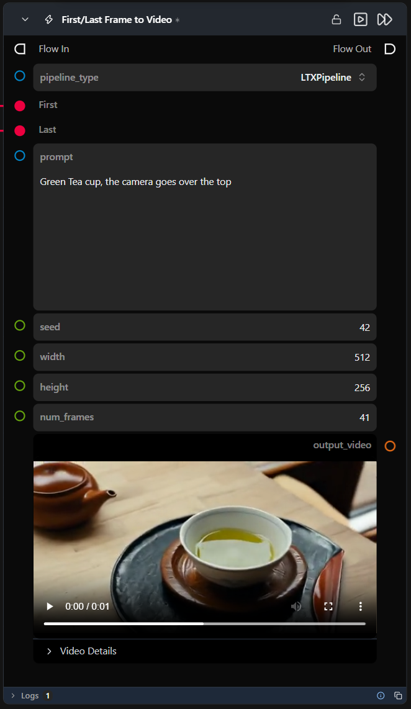

# First/Last Frame to Video

**A preconfigured, self-contained workflow that generates a video conditioned on a first and a last frame plus a text prompt — dropped in as a single node.**

Category: `ModularDiffusion/Preconfigured`

## TL;DR
- Ships configured with default strengths at `1.0`; `pipeline_type` also offers various supported pipeline types.
- Outputs `output_video` (`VideoUrlArtifact`).

## Typical workflow position
```text
Load Image (first) ──┐
                      ├─→ [First/Last Frame to Video] → Display Video
Load Image (last)  ──┘
```

## Node preview



## Inputs

| Name | Type | Required | Notes |
| --- | --- | --- | --- |
| `pipeline_type` | Supported Pipeline Types | Yes | Selects which pipeline family the internal Pipeline Builder resolves and builds. |
| `image_0` (display name "First") | `ImageUrlArtifact` | Yes | First-frame conditioning image, forwarded to the internal Media Generation Conditioning node. |
| `image_1` (display name "Last") | `ImageUrlArtifact` | Yes | Last-frame conditioning image, forwarded to the internal Media Generation Conditioning node. |
| `prompt` | str | Yes | Positive text prompt, forwarded to the internal Generate Media Latents node. |
| `seed` | int | No | Forwarded to the internal Create Noise Latents node. |
| `width` | int |Yes | Forwarded to the internal Create Noise Latents node. |
| `height` | int | Yes | Forwarded to the internal Create Noise Latents node. |
| `num_frames` | int | No | Forwarded to the internal Create Noise Latents node. |

## Outputs

| Name | Type | Notes |
| --- | --- | --- |
| `output_video` | `VideoUrlArtifact` | Decoded video from the latent tensor. |
| `was_successful` | bool | Whether the internal sub-flow completed without errors. |
| `result_details` | str | Details about the operation result. |

## Provider / model behavior

This workflow ships configured with a default model, and the internal Modular Diffusion Pipeline Builder node's `pipeline_type` also accepts various supported pipeline types.
The internal Media Generation Conditioning node is pre-set with `image_preset="First + Last"` and `num_images=2` (hidden), with both `image_0_strength` and `image_1_strength` at `1.0` (full conditioning strength for each frame).

The internal Generate Media Latents node ships with `guidance_scale=3.0` and `num_inference_steps=40`. Its runtime-parameter tooltips explicitly reference recommended values regardless of the selected `pipeline_type` — the runtime-parameters class backing this node appears to be shared with a driver. The numeric defaults still apply; treat the specific wording in the tooltips as inherited boilerplate.

## Tips & pitfalls

- **This is a complete sub-flow, not a single primitive.** Double-click the node (or open its sub-flow) to see and tweak the internal Media Generation Conditioning / Create Noise Latents / Pipeline Builder / Generate Media Latents / Decode Media chain.
- **Fixed model selection.** You cannot change the model selection or other internal parameters directly from the top-level node; you must open the sub-flow to make changes.
- **No download status visibility.** There is no visual indication within the node itself whether the required model has been downloaded or if it needs to be installed via the Model Manager.
- **Model Installation**: Use the Model Manager (via the internal builder's `model_download` button) to install the model before running.
- **`add_noise` is disabled on the internal Generate node.** The Create Noise Latents node already supplies a pure-noise starting latent, so the Generate node denoises it directly without re-noising. The seed set here fully controls reproducibility.
- **Frame conditioning strength is fixed at `1.0` for both frames.** Open the sub-flow and adjust `image_0_strength`/`image_1_strength` on the Media Generation Conditioning node for a softer blend.
- **The internal Generate node's guidance tooltips mention recommended values** regardless of the selected `pipeline_type` — a wording leftover from a shared runtime-parameters class. The numeric defaults (`guidance_scale=3.0`, `num_inference_steps=40`) still apply.
- **Want more granular control?** Open the sub-flow and edit the internal nodes directly — anything not exposed as a top-level input here can be changed there.

## See also

- [Text to Image](text_to_image.md) · [Inpainting](inpainting.md) · [Text to Video](text_to_video.md)
- [Media Generation Conditioning](media_gen_conditioning.md) · [Modular Diffusion Pipeline Builder](pipeline_builder.md) · [Generate Media Latents](generate_media_latents.md) — the nodes this workflow wraps internally.
