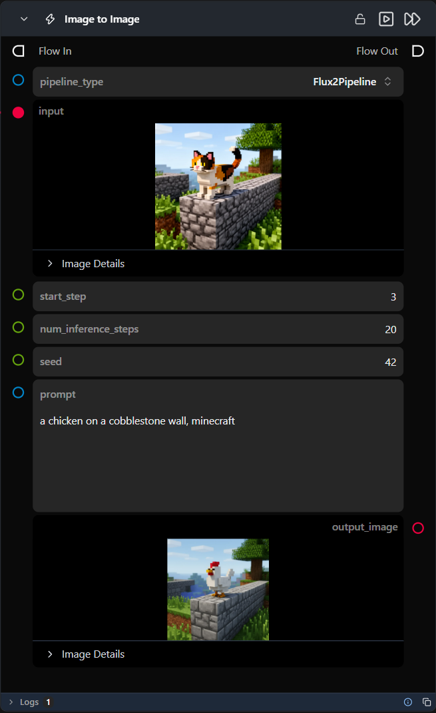

# Image to Image

**A preconfigured, self-contained workflow that regenerates an input image from a text prompt — dropped in as a single node.**

Category: `ModularDiffusion/Preconfigured`

## TL;DR
- One node wraps a full Pipeline Builder → Encode Media → Generate → Decode chain for various supported image-to-image pipelines.
- `start_step` controls how much of the source image is preserved. It must be less than or equal to num inference.
- Pipeline defaults to a supported model; open the sub-flow to change the model repo or any hidden parameter.
- Outputs `output_image` (`ImageUrlArtifact`)

## Typical workflow position
```text
Load Image → [Image to Image] → Display Image
```

## Node preview



## Inputs

| Name | Type | Required | Notes |
| --- | --- | --- | --- |
| `pipeline_type` | Supported Pipeline Types | Yes | Selects which pipeline family the internal Pipeline Builder resolves and builds. |
| `input` | `ImageArtifact` / `ImageUrlArtifact` | Yes | Source image, forwarded to the internal Encode Media Latent node. |
| `start_step` | int | No | Default `5`. Which denoising step to start from — higher values preserve more of the source image. |
| `num_inference_steps` | int | No | Forwarded to the internal Generate Media Latents node. |
| `seed` | int | No | Default `42`. Forwarded to the internal Generate Media Latents node. |
| `prompt` | str | Yes | Positive text prompt, forwarded to the internal Generate Media Latents node. |

## Outputs

| Name | Type | Notes |
| --- | --- | --- |
| `output_image` | `ImageUrlArtifact` | Decoded image from the latent tensor. |
| `was_successful` | bool | Whether the internal sub-flow completed without errors. |
| `result_details` | str | Details about the operation result. |

## Provider / model behavior

This workflow ships with a default model pre-set for every supported `pipeline_type` — switching `pipeline_type` updates the internal Pipeline Builder node's `model` to a matching default, so no sub-flow edit is required to try a different architecture.

## Tips & pitfalls

- **This is a complete sub-flow, not a single primitive.** Double-click the node (or open its sub-flow) to see and tweak the internal Encode Media Latent / Pipeline Builder / Generate Media Latents / Decode Media Latent chain, including hidden parameters like `model` repo and optimization toggles.
- **Fixed model selection.** You cannot change the model selection or other internal parameters directly from the top-level node; you must open the sub-flow to make changes.
- **No download status visibility.** There is no visual indication within the node itself whether the required model has been downloaded or if it needs to be installed via the Model Manager.
- **`start_step` controls fidelity to the source image.** Lower values allow more deviation from `input`; higher values stay closer to it. Open the sub-flow to see how it maps onto the internal Generate Media Latents node's partial-denoise range.
- **Want more granular control?** Open the sub-flow and edit the internal nodes directly — anything not exposed as a top-level input here can be changed there.

## See also

- [Text to Image](text_to_image.md) · [Inpainting](inpainting.md) · [Text to Video](text_to_video.md) · [First/Last Frame to Video](first_last_frame_to_video.md)
- [Modular Diffusion Pipeline Builder](pipeline_builder.md) · [Encode Media Latent](encode_media_latent.md) · [Generate Media Latents](generate_media_latents.md) — the nodes this workflow wraps internally.
