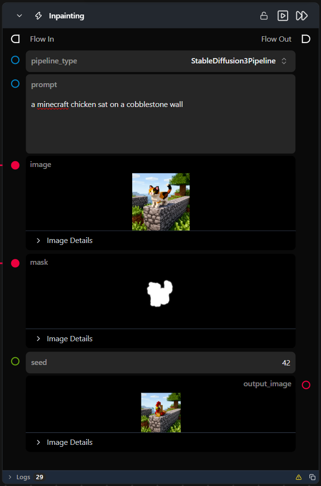

# Inpainting

**A preconfigured, self-contained workflow that inpaints a masked region of an image using a text prompt — dropped in as a single node.**

Category: `ModularDiffusion/Preconfigured`

## TL;DR
- One node wraps a full Pipeline Builder → Encode Masked Media → Generate → Decode chain pre-set for inpainting checkpoints.
- Pipeline defaults to a supported model; open the sub-flow to change the model repo or any hidden parameter.
- Outputs `output_image` (`ImageUrlArtifact`)

## Typical workflow position
```text
Load Image ──┐
             ├─→ [Inpainting] → Display Image
Paint Mask ──┘
```

## Node preview



## Inputs

| Name | Type | Required | Notes |
| --- | --- | --- | --- |
| `pipeline_type` | Supported Pipeline Types | Yes | Selects which pipeline family the internal Pipeline Builder resolves and builds. |
| `prompt` | str | Yes | Positive text prompt describing what should appear in the masked region. |
| `image` | `ImageArtifact` / `ImageUrlArtifact` | Yes | Source image. |
| `mask` | `ImageArtifact` / `ImageUrlArtifact` | Yes | Binary mask — white pixels = inpaint region, black = keep original. |
| `seed` | int | No | Forwarded to the internal Generate Media Latents node. |

## Outputs

| Name | Type | Notes |
| --- | --- | --- |
| `output_image` | `ImageUrlArtifact` | Decoded image from the latent tensor. |
| `was_successful` | bool | Whether the internal sub-flow completed without errors. |
| `result_details` | str | Details about the operation result. |

## Provider / model behavior

This workflow ships with a default model pre-set for every supported `pipeline_type` — switching `pipeline_type` updates the internal Pipeline Builder node's `model` to a matching default, so no sub-flow edit is required to try a different architecture.

The internal Encode Masked Media Latent node's `strength` is set to `1.0` for this workflow (full replacement of the masked region), rather than that node's own default of `0.95`. Open the sub-flow to change it.

## Tips & pitfalls

- **This is a complete sub-flow, not a single primitive.** Double-click the node (or open its sub-flow) to see and tweak the internal Pipeline Builder / Encode Masked Media Latent / Generate Media Latents / Decode Media Latent chain.
- **Fixed model selection.** You cannot change the model selection or other internal parameters directly from the top-level node; you must open the sub-flow to make changes.
- **No download status visibility.** There is no visual indication within the node itself whether the required model has been downloaded or if it needs to be installed via the Model Manager.
- **Mask is resized to match the (possibly snapped) source image automatically**, per the underlying [Encode Masked Media Latent](encode_masked_media_latent.md) node.
- **Want more granular control?** Open the sub-flow and edit the internal nodes directly — anything not exposed as a top-level input here can be changed there.

## See also

- [Text to Image](text_to_image.md) · [Image to Image](image_to_image.md) · [Text to Video](text_to_video.md) · [First/Last Frame to Video](first_last_frame_to_video.md)
- [Modular Diffusion Pipeline Builder](pipeline_builder.md) · [Encode Masked Media Latent](encode_masked_media_latent.md) · [Generate Media Latents](generate_media_latents.md) — the nodes this workflow wraps internally.
