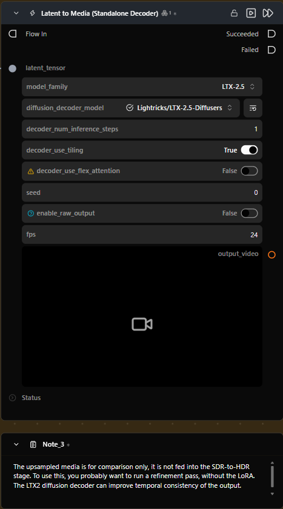

# Latent to Media (Standalone Decoder)

**Runs a selected model on its own to turn a compatible latent tensor into an image or video, with no pipeline connection required.**

Category: `ModularDiffusion/Encode\Decode`

## TL;DR
- Standalone alternative to [Decode Media Latent](decode_media_latent.md) for the models both nodes support (for example LTX-2): it loads its own model instead of reusing a connected `pipeline`, and runs inference itself.
- Select a model family (for example a diffusion decoder) and connect its compatible `LatentArtifact` input.
- Output type follows the selected model: image models expose `output_image`, while video models expose `output_video` and `fps`.
- Normal mode exposes PIL output; raw mode exposes the model's NumPy values unchanged through `raw_media`, with no guaranteed range or color-space interpretation.
- The LTX-2.5 diffusion decoder is the initial supported model and decodes LTX-2 video latents. Other model families, including ones that do not use diffusion, may be added later.

## Typical workflow position
```text
Generate Media Latents → [Latent to Media] → Save Video
```

## Node preview

<!-- TODO: add docs/assets/nodes/latent-to-media.png screenshot -->


## Inputs

| Name | Type | Required | Notes |
| --- | --- | --- | --- |
| `latent_tensor` | `LatentArtifact` | Yes | Latent tensor produced by a compatible model. |

## Outputs

| Name | Type | Notes |
| --- | --- | --- |
| `output_image` | `ImageUrlArtifact` | Present when the selected decoder supports images. |
| `output_video` | `VideoUrlArtifact` | Present when the selected decoder supports video. |
| `raw_media` | `FloatMediaArtifact` | Present in raw mode; unmodified floating-point RGB from the decoder's NumPy path, with no guaranteed range or color-space interpretation. |

## Parameters

Common controls are available for every model family; settings specific to a family appear only when it is selected.

### Common

| Name | Type | Default | Notes |
| --- | --- | --- | --- |
| `model_family` | str | `LTX-2.5` | Selects the model family and its model-specific settings. |
| `seed` | int | `0` | Use a non-negative value for repeatable output; `-1` leaves the generator unset for pipeline-default randomness. |
| `enable_raw_output` | bool | `False` | Exposes decoder NumPy output as `raw_media`; display output is a separate clipped preview. |

### Video decoders

| Name | Type | Default | Notes |
| --- | --- | --- | --- |
| `fps` | int (1–120) | `24` | Sets video frame rate; shown only for video decoder models. |

### LTX-2.5 diffusion decoder

| Name | Type | Default | Notes |
| --- | --- | --- | --- |
| `diffusion_decoder_model` | repo | `Lightricks/LTX-2.5-Diffusers` | Selects the decoder weights; download the repo through Model Manager before decoding. |
| `decoder_num_inference_steps` | int | `1` | Number of denoising steps for the LTX-2.5 diffusion decoder. |
| `decoder_use_tiling` | bool | `True` | Enables overlapping tiles to lower peak memory use on large videos. |
| `decoder_use_flex_attention` | bool | `False` | Uses the original FlexAttention path when matching the reference attention behavior matters more than memory efficiency; at video resolutions, it can require tens of GB of GPU VRAM and may run out of memory. |

## Provider / model behavior

| Model family | Behavior |
| --- | --- |
| LTX-2.5 (diffusion decoder) | Decodes compatible 5-D LTX-2 video latents by running the diffusion decoder, and publishes an MP4. Its model repository contains the decoder weights. |

> **Warning:** The FlexAttention processor that diffusers uses by default is uncompiled, so it materialises the full score matrix. At video resolutions, it can require tens of GB of GPU VRAM and may run out of memory. The NATTEN kernels used by the original implementation are only prebuilt for Linux and WSL, so this library cannot use them on native Windows.

> **Note:** This library uses chunked attention by default to cap memory. Enable `decoder_use_flex_attention` when matching the original FlexAttention reference path matters more than VRAM use. The chunked approach processes queries in chunks, a known technique (Rabe and Staats, 2021, "Self-attention Does Not Need O(n²) Memory").

The node's decoder specification selects the output media type. FPS is shown only for video decoders. In normal mode, the decoder returns PIL media. In raw mode, it returns floating-point NumPy RGB through `raw_media`; image data uses `(H, W, 3)` and video uses `(F, H, W, 3)`. Values are unchanged by this node and have no guaranteed range or color-space interpretation. The regular image or video output is generated separately by clipping values to `[0, 1]` and converting to 8-bit display media.

## Tips & pitfalls

- **Use a compatible latent.** LTX-2.5 decoding expects the video latent shape and normalization produced by an LTX-2-family pipeline.
- **Download the selected repository first.** The LTX-2.5 Diffusers repository is gated on Hugging Face and requires accepting its terms and authenticating before download.
- **Keep tiling enabled for large videos.** Tiling is enabled by default and reduces peak decoder memory by processing overlapping output regions.

## See also

- [Generate Media Latents](generate_media_latents.md) — produces compatible video latents.
- [Decode Media Latent](decode_media_latent.md) — passive VAE decode that requires a connected pipeline.
