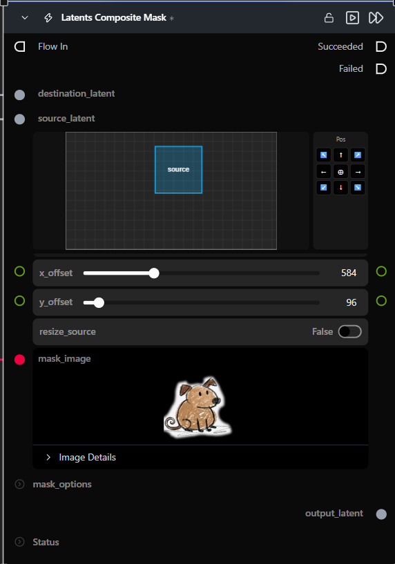

# Composite Latents with Mask

**Pastes a source latent onto a destination latent at a given pixel offset, blended through an optional image mask.**

Category: `ModularDiffusion/Transform`

## TL;DR
- Drop a source latent into a destination latent at `(x_offset, y_offset)`. White mask pixels → source; black → destination.
- Offsets are **pixel-space**; the node converts to latent space internally (÷ 8).
- Enable `resize_source` to scale the source to the destination's spatial size before compositing.
- Mask is automatically resampled to match the source latent.
- Use the **placement editor** to drag the source into place, or set the offsets directly; the two stay in sync.

## Typical workflow position
```text
Generate Latent (dest) ────┐
Generate Latent (src) ─────┼─→ [Composite Latents with Mask] → Generate Latent
Paint Mask (mask) ─────────┘
```

## Node preview



## Inputs

| Name | Type | Required | Notes |
| --- | --- | --- | --- |
| `destination_latent` | `LatentArtifact` | Yes | Base canvas. |
| `source_latent` | `LatentArtifact` | Yes | Latent to paste in. |
| `mask_image` | `ImageArtifact` / `ImageUrlArtifact` | No | Blend mask. If omitted, the source replaces the destination wholesale within its placement region. |

## Outputs

| Name | Type | Notes |
| --- | --- | --- |
| `output_latent` | `LatentArtifact` | Destination with source composited in. |

## Parameters

### Placement

| Name | Type | Default | Notes |
| --- | --- | --- | --- |
| `placement_editor` | widget | — | Drag the source box over the destination, or pick a position preset. Writes `x_offset` / `y_offset` (snapped to multiples of 8) and toggles `resize_source`. Shows latent sizes after the node has run once. A connected offset is left to its connection. |
| `x_offset` | int (pixels; slider −2000 to 2000, larger values accepted) | `0` | Horizontal placement (divided by 8 internally). |
| `y_offset` | int (pixels; slider −2000 to 2000, larger values accepted) | `0` | Vertical placement (divided by 8 internally). |
| `resize_source` | bool | `False` | Bilinearly resize source to match destination spatial size before compositing. |

### Mask options *(collapsed by default)*

| Name | Type | Default | Notes |
| --- | --- | --- | --- |
| `channel` | choice | `alpha` | Which channel of `mask_image` to use as blend weight. |
| `invert_mask` | bool | `False` | Swap source/destination regions. |
| `grow_shrink` | float (-100..100) | `0` | Dilate (+) or erode (-) the mask edge. |
| `blur_mask` | float (0..100) | `0` | Feather the mask edge. |

## Tips & pitfalls

- **Only the overlapping region is composited.** Offsets can be negative, so the source can hang off the top or left edge as well. If the source extends beyond the destination canvas on any side, the out-of-bounds portion is ignored; if source and destination don't intersect at all, the destination is returned unchanged.
- **The placement editor needs one run.** Latent sizes are only known where the node runs, so the editor is blank until the first run and refreshes on every run after. Sizes are saved with the workflow once you place the source in the editor; otherwise a reopened workflow shows a blank editor until the next run.
- **`resize_source` still uses the offsets.** The resized source is as large as the destination, so a non-zero offset shifts it and clips its far edge. The editor shows this; a position preset in the editor resets it to 0, 0 for a full replacement.
- **Pixel offsets, not latent offsets.** A 1024-px destination = 128 latent units. Offsets are in the bigger pixel space — the node divides by the VAE scale factor (8) internally.
- **Works for both 4D image latents and 5D video latents.** The mask is broadcast across the temporal dimension.
- **Output inherits the destination's `shape`. Metadata is merged; on key conflicts the destination wins.**

## See also

- [Create Empty Latent](empty_latents.md) — typical destination canvas.
- [Add Latents](add_latents.md) — for unmasked elementwise blending.
