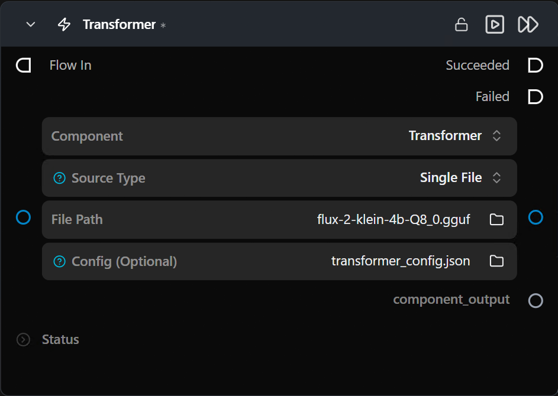

# Load Component

**Loads a single pipeline component (transformer / unet / vae / tokenizer / text encoder) from disk or the local HuggingFace cache.**

Category: `Diffusion/Pipeline`

## TL;DR
- Emits a `ComponentArtifact` that points to the component weights. The Build Pipeline node loads them when building the pipeline.
- Three source modes: a single-file checkpoint (`.gguf` / `.safetensors` / …), a diffusers-format component folder, or a HuggingFace repo id already in your local cache.
- All modes run with local files in the cache only, nothing is downloaded. Use the model manager UI to download models & repo you might need.
- Connect this output to the component override port on the Build Pipeline node that matches your selection (Transformer / UNet / VAE / Tokenizer / Text Encoder).

## Typical workflow position
```text
[Load Component] → Build Pipeline (component override) → Generate Latent
```

## Node preview



## Inputs

_None. All fields are node properties._

## Outputs

| Name | Type | Notes |
| --- | --- | --- |
| `component_output` | `<Component>ComponentArtifact` | Descriptor for the selected component. Artifact type follows the `Component` selection (e.g. `TransformerComponentArtifact` for Transformer). Connect it to the matching component override slot on the Build Pipeline node. |

## Parameters

### Common

| Name | Type | Default | Notes |
| --- | --- | --- | --- |
| `component` | `Transformer \| UNet \| VAE \| Tokenizer \| Text Encoder` | `Transformer` | Which pipeline slot this loader targets. Changing this updates the output artifact type and drops any outgoing connections. |
| `source_type` | `Single File \| Local Folder \| HuggingFace Repo` | `Single File` | Selects which of the parameter groups below is active. The other groups are hidden. **Note:** Single File is not supported for Tokenizer — use Local Folder or HuggingFace Repo instead. |

### Single File

| Name | Type | Default | Notes |
| --- | --- | --- | --- |
| `file_path` | `str` (file) | `""` | Absolute path to a single-file weight (`.gguf`, `.safetensors`, `.ckpt`, `.pt`, `.pth`, `.bin`). A Text Encoder accepts only `.gguf`. |
| `config_source` | `str` | `""` | **Config (Optional)** this is a json file (e.g. `config.json`) that tells Griptape how to read a single-file model. For first-time use, click the config link in the badge of the matching port on the [Build Pipeline](pipeline_builder.md) node to open its Hugging Face file page, click **Download** there, then select the downloaded file here. This downloads the config only, not the full model. The config must come from the same model as your file. Leave empty only if the matching config is already in the local Hugging Face cache. Text Encoder GGUF reads the `config.json` next to the GGUF, so this field does not apply. |

### Local Folder

| Name | Type | Default | Notes |
| --- | --- | --- | --- |
| `folder_path` | `str` (dir) | `""` | Absolute path to a diffusers-format component folder. For model components (Transformer, UNet, VAE, Text Encoder) this folder must contain `config.json` plus weight file(s), e.g. `.../FLUX.1-dev/transformer/`. For Tokenizer components it must contain `tokenizer_config.json`, e.g. `.../FLUX.1-dev/tokenizer/`. |

### HuggingFace Repo

| Name | Type | Default | Notes |
| --- | --- | --- | --- |
| `repo_id` | `str` | `""` | HuggingFace repo id in `repo/id` form, e.g. `black-forest-labs/FLUX.1-dev`. Must already be in the local HF cache; no downloads are triggered from here. A refresh (↺) button next to the field re-checks the local cache. If the repo is not cached, an **Open Model Manager to Download** button appears below the field — clicking it opens Model Management pre-filtered to that repo. Run-time validation fails if the repo is not cached. |
| `revision` | `str` | `"main"` | Repo revision, e.g. a branch, tag, or commit hash. |
| `subfolder` | `str` | `""` | Subfolder inside the repo containing the component. Blank means auto-derived from the selected `component` (`transformer`, `unet`, `vae`, `tokenizer`, `text_encoder`). For numbered variants (e.g. `transformer_2`, `tokenizer_2`), specify the subfolder manually. |

## Tips & pitfalls

- **Pick the component folder, not the pipeline root.** For Local Folder, `.../FLUX.1-dev/` is wrong; `.../FLUX.1-dev/transformer/` is right. For model components the validator checks for `config.json`; for Tokenizer it checks for `tokenizer_config.json`.
- **HuggingFace Repo mode is cache-only.** If the repo id you enter is not in your local HF cache, use the **Open Model Manager to Download** button that appears below the field, or click the refresh (↺) button after downloading to re-check.
- **Use pre-downloaded models for fastest setup.** The HuggingFace Repo mode reads from your local cache without any downloads, so you can work offline once the model is cached.
- **Rebuild cleanly by changing any field.** This node computes a hash that includes every visible parameter (including `revision` and `subfolder`), so updating any value automatically triggers a fresh pipeline build.
- **Output type follows your component selection.** When you switch `component`, the output artifact type updates to match, and you can wire it to the corresponding component override slot on the Build Pipeline node.
- **Smart subfolder defaults.** The `subfolder` field auto-fills with the component name (`transformer` / `unet` / `vae` / `tokenizer` / `text_encoder`), which works for standard repo layouts. Override it manually for non-standard structures (e.g. `tokenizer_2`, `text_encoder_2`).
- **Open, download, then select the matching config.** The badge on the matching port of [Build Pipeline](pipeline_builder.md) links to the config's Hugging Face file page. Open that link, click **Download** on the page, then select the downloaded file in **Config (Optional)**. The config must come from the same model as your single file; you do not need to download the full model.
- **Tokenizer doesn't support Single File.** Tokenizer components are vocabulary/config files, not weight checkpoints. Single File mode will be rejected at validation — use Local Folder or HuggingFace Repo for tokenizers.

## See also

- [Build Pipeline](pipeline_builder.md) · [Load LoRA](load_lora.md)
