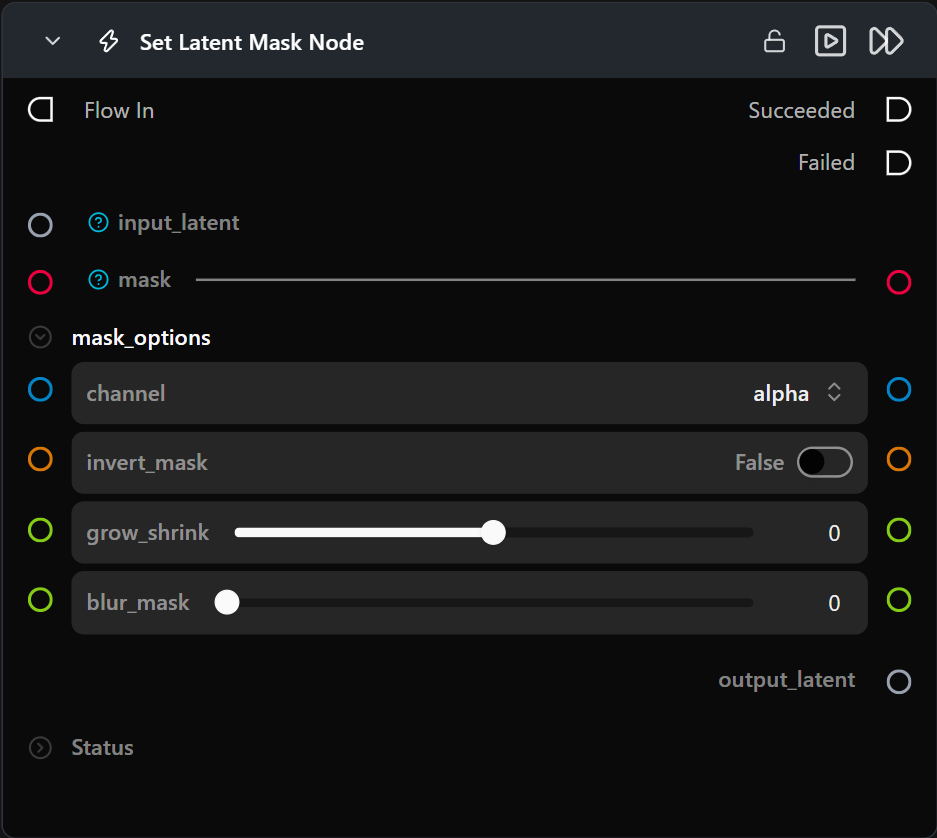

# Set Latent Mask

**Bundles an image or video latent with a mask image.**

Category: `ModularDiffusion/Transform`

## TL;DR
- Connect an image or video `LatentArtifact` from Encode Media and a mask image.
- Choose the mask channel and optionally invert, grow/shrink, or blur the mask.
- `output_latent` carries the latent and the processed mask together.
- Connect `output_latent` to [Generate Media Latents](generate_media_latents.md) with `add_noise` on, and only the masked areas are redone while the rest stays close to the original ([Differential Diffusion](https://arxiv.org/abs/2306.00950)).

## Typical workflow position
```text
Encode Media ─────────┐
                      ├─→ [Set Latent Mask] ──→ Generate Media Latents (add_noise on) → Decode Media
Paint Mask ───────────┘
```

## Node preview



## Inputs

| Name | Type | Required | Notes |
| --- | --- | --- | --- |
| `input_latent` | `LatentArtifact` | Yes | 4-D image or 5-D video latent from Encode Media. |
| `mask_image` | `ImageUrlArtifact` | Yes | Mask image; select its channel and optionally invert, grow/shrink, or blur it. |

## Outputs

| Name | Type | Notes |
| --- | --- | --- |
| `output_latent` | `MaskedLatentArtifact` | The input latent bundled with the processed mask. |

## Parameters

### Mask options

| Name | Type | Default | Notes |
| --- | --- | --- | --- |
| `channel` | `str` | `"red"` | Channel extracted from the mask image (`red`, `green`, `blue`, or `alpha`). |
| `invert_mask` | `bool` | `False` | Inverts the extracted mask. |
| `grow_shrink` | `float` | `0` | Mask growth/shrink amount in pixels, from -100 to 100. Positive values shrink (erode) the mask; negative values grow (dilate) it. |
| `blur_mask` | `float` | `0` | Mask blur radius, from 0 to 100. |

Mask operations are applied in this order: grow/shrink, then invert, then blur.

## Tips & pitfalls

- **Connect an image or video latent.** For a video latent, the same mask is applied to every frame.
- **White is fully selected, black is not selected, and grey is partial.** Use `invert_mask` to swap them.
- **The mask is resized to the latent when it is converted to a tensor.**
- **The output is in-process only.** It is held where it was created and cannot be saved or sent to another process.
- **For masked denoising, turn `add_noise` on in Generate Media Latents.** The run then starts from a noised copy of your image, which lets the masked areas be redone.[Generate Media Latents](generate_media_latents.md) lists the pipelines that work with masked denoising. Paint white to redo and black to keep. Grey values give partial redo strength; the lighter the grey, the longer that area can change.

## See also

- [Encode Media](encode_media_latent.md) · [Decode Media](decode_media_latent.md)
