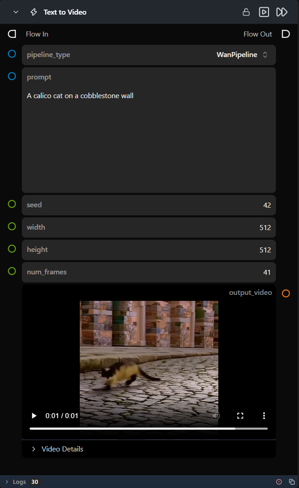

# Text to Video

**A preconfigured, self-contained workflow that generates a video from a text prompt — dropped in as a single node.**

Category: `ModularDiffusion/Preconfigured`

## TL;DR
- One node wraps a full Pipeline Builder → Noise → Generate → Decode chain for various supported text-to-video pipelines.
- Pipeline defaults to a supported model; open the sub-flow to change the model repo or any hidden parameter.
- Outputs `output_video` (`VideoUrlArtifact`).

## Typical workflow position
```text
[Text to Video] → Display Video
```

## Node preview



## Inputs

| Name | Type | Required | Notes |
| --- | --- | --- | --- |
| `pipeline_type` | Supported Pipeline Types | Yes | Selects which pipeline family the internal Pipeline Builder resolves and builds. |
| `prompt` | str | Yes | Positive text prompt, forwarded to the internal Generate Media Latents node. |
| `seed` | int | No | Forwarded to the internal Create Noise Latents node. |
| `width` | int | No | Forwarded to the internal Create Noise Latents node. |
| `height` | int | No | Forwarded to the internal Create Noise Latents node. |
| `num_frames` | int | No | Forwarded to the internal Create Noise Latents node. |

## Outputs

| Name | Type | Notes |
| --- | --- | --- |
| `output_video` | `VideoUrlArtifact` | Decoded video from the latent tensor. |
| `was_successful` | bool | Whether the internal sub-flow completed without errors. |
| `result_details` | str | Details about the operation result. |

## Provider / model behavior

This workflow ships with a default model pre-set for every supported `pipeline_type` — switching `pipeline_type` updates the internal Pipeline Builder node's `model` to a matching default, so no sub-flow edit is required to try a different architecture.

## Tips & pitfalls

- **This is a complete sub-flow, not a single primitive.** Double-click the node (or open its sub-flow) to see and tweak the internal Create Noise Latents / Pipeline Builder / Generate Media Latents / Decode Media chain, including hidden parameters like `model` repo and optimization toggles.
- **Fixed model selection.** You cannot change the model selection or other internal parameters directly from the top-level node; you must open the sub-flow to make changes.
- **No download status visibility.** There is no visual indication within the node itself whether the required model has been downloaded or if it needs to be installed via the Model Manager.
- **`guidance_scale` and `num_inference_steps` are fixed inside the sub-flow.** They are not exposed as top-level inputs; edit the internal Generate Media Latents node to change them.
- **The internal `num_inference_steps` tooltip mentions recommended values** instead of "video" — a wording leftover in the underlying node's runtime parameters; the setting still controls video denoising steps as expected.
- **`add_noise` is disabled on the internal Generate node.** The Create Noise Latents node already supplies a pure-noise starting latent, so the Generate node denoises it directly without re-noising. The seed set here fully controls reproducibility.
- **Want more granular control?** Open the sub-flow and edit the internal nodes directly — anything not exposed as a top-level input here can be changed there.

## See also
- [Modular Diffusion Pipeline Builder](pipeline_builder.md) · [Generate Media Latents](generate_media_latents.md) — the nodes this workflow wraps internally.
