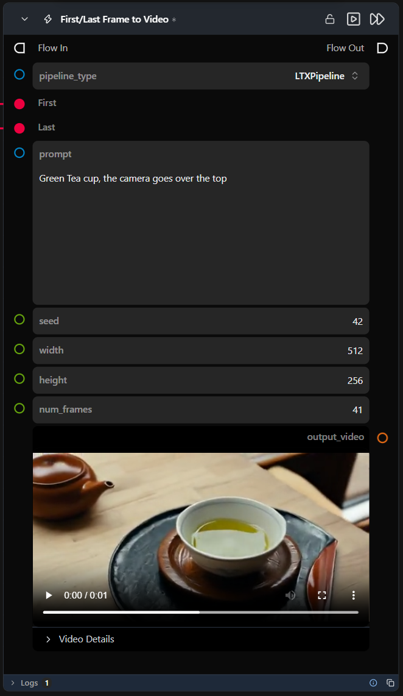

## When to use it

This node makes a video that starts on your first image and ends on your last image. The model fills in the motion between them, guided by a text description called a prompt. It is like giving an animator the first and last keyframes. It is a ready-made node that wraps a whole workflow, so you get one node instead of the full graph. The library marks it as a Labs node.

To see how the pieces connect, or to change the model, open the [FirstAndLastFrameImage2Video](../workflows/FirstAndLastFrameImage2Video.md) template. That template uses a different model and settings than this node.

Inside, the node runs [Build Pipeline](../nodes/LatentDiffusionPipelineBuilderNode.md), [Reference Media](../nodes/MediaGenConditioningNode.md), [Create Noise Latent](../nodes/NoiseLatentNode.md), [Generate Latent](../nodes/DiffusionPipelineGenerateLatentNode.md) and [Decode Media](../nodes/VaeDecodeNode.md). Reference Media is set to First + Last, and both frames are used at full strength. The video is made as a [latent](../guides/what-is-a-latent.md), the compressed form of a clip that the model works in, and decoded at the end.

## What it needs

- A first image, a last image and a prompt. Pick two images that could belong to the same shot.
- The model for the `pipeline_type` you pick, downloaded in advance in Model Manager. See [Hugging Face and Diffusers](../guides/hugging-face-and-diffusers.md). The default type is `LTXPipeline`.

## Where it fits

```text
Load Image (first) ──┐
                     ├─→ [First/Last Frame to Video] → Display Video
Load Image (last) ───┘
```



## Parameters

### pipeline_type

The model family to use. The default is `LTXPipeline`. The choices are `LTXPipeline`, `LTX2Pipeline`, `LTX-2.5 Distilled` and `LTX-2.5 Full (SFT)`. Each choice picks its own model. See [How pipelines work](../guides/how-pipelines-work.md).

### image_0

The first frame of the video.

### image_1

The last frame of the video.

### prompt

A description of the motion between the two frames.

### seed

Default 42. The seed decides which noise the video starts from. The same seed and prompt give the same video.

### width

Video width in pixels. The default is 1024.

### height

Video height in pixels. The default is 1024.

### num_frames

How many frames the video has. The default is 41. The workflow plays the video at 25 frames per second, so 41 frames last about 1.6 seconds. Pipelines that make their own soundtrack, such as LTX2, play at 24 frames per second instead, so 41 frames last about 1.7 seconds.

### output_video

The finished video.
