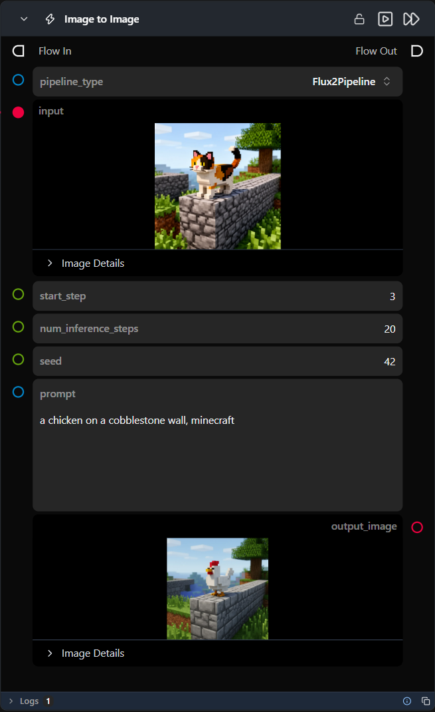

## When to use it

This node takes an image you already have and repaints it to match a text description, called a prompt. It keeps the overall layout. It is a ready-made node that wraps a whole workflow, so you get one node instead of the full graph. The library marks it as a Labs node.

To see how the pieces connect, or to change the model, open the [Image2Image](../workflows/Image2Image.md) template.

The default `pipeline_type` here is `Flux2KleinPipeline`. The Image2Image template uses Z-Image Turbo (`Tongyi-MAI/Z-Image-Turbo`) instead.

Inside, the node runs [Build Pipeline](../nodes/LatentDiffusionPipelineBuilderNode.md), [Encode Media](../nodes/VaeEncodeNode.md), [Generate Latent](../nodes/DiffusionPipelineGenerateLatentNode.md) and [Decode Media](../nodes/VaeDecodeNode.md). Your image becomes a [latent](../guides/what-is-a-latent.md), the compressed form of an image that the model works in. The model adds noise to it and removes the noise again, guided by the prompt.

## What it needs

- An image and a prompt.
- The model for the `pipeline_type` you pick, downloaded in advance in Model Manager. See [Hugging Face and Diffusers](../guides/hugging-face-and-diffusers.md). The default type is `Flux2KleinPipeline`.

## Where it fits

```text
Load Image → [Image to Image] → Display Image
```



## Parameters

### pipeline_type

The model family to use. The default is `Flux2KleinPipeline`. The choices are `FluxPipeline`, `FluxKontextPipeline`, `Flux2Pipeline`, `Flux2KleinPipeline`, `QwenImagePipeline`, `StableDiffusionXLPipeline`, `StableDiffusion3Pipeline` and `ZImagePipeline`. Each choice picks its own model. See [How pipelines work](../guides/how-pipelines-work.md).

### input

The image to rework.

### start_step

Default 5. The step the run starts from, out of `num_inference_steps`. Early steps decide the layout. A higher value skips more of them, so the result stays closer to your image. A lower value changes more. See [When noise is added](../guides/what-is-a-latent.md#when-noise-is-added).

### num_inference_steps

How many steps the model takes to remove the noise. The default is 20.

### seed

Default 42. The seed decides which noise is added to your image.

### prompt

The description of the result you want.

### output_image

The reworked image.
