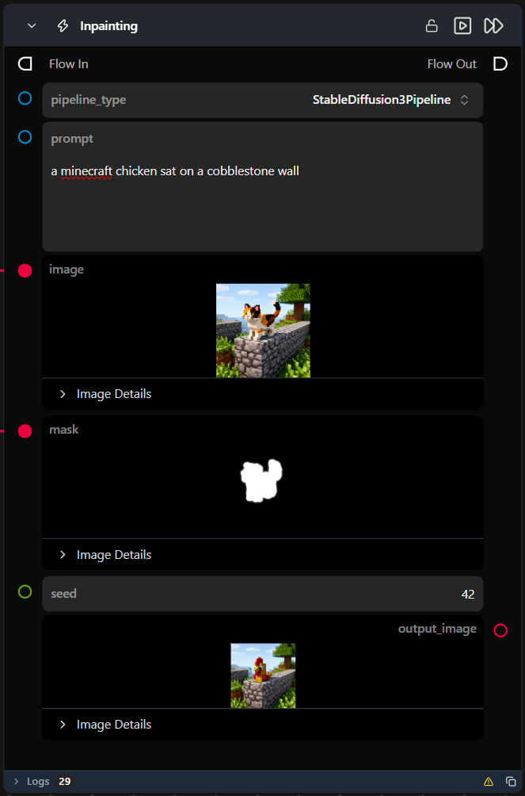

## When to use it

This node repaints only the area you mask, to match a text description called a prompt. This is called inpainting. It is a ready-made node that wraps a whole workflow, so you get one node instead of the full graph. The library marks it as a Labs node.

To see how the pieces connect, or to change the model or the strength, open the [Inpainting](../workflows/Inpainting.md) template.

Inside, the node runs [Build Pipeline](../nodes/LatentDiffusionPipelineBuilderNode.md), [Encode Masked Media](../nodes/VaeMaskEncodeNode.md), [Generate Latent](../nodes/DiffusionPipelineGenerateLatentNode.md) and [Decode Media](../nodes/VaeDecodeNode.md). The image and mask become a [latent](../guides/what-is-a-latent.md), the compressed form of an image that the model works in. Only the masked area is redrawn.

## What it needs

- An image, a mask and a prompt.
- The model for the `pipeline_type` you pick, downloaded in advance in Model Manager. See [Hugging Face and Diffusers](../guides/hugging-face-and-diffusers.md). The default type, `Flux2KleinPipeline`, uses `black-forest-labs/FLUX.2-klein-4B`.

## Where it fits

```text
Load Image ──┐
             ├─→ [Inpaint Image] → Display Image
Paint Mask ──┘
```



## Parameters

### pipeline_type

The model family to use. The default is `Flux2KleinPipeline`. The choices are `FluxPipeline`, `FluxKontextPipeline`, `FluxFillPipeline`, `Flux2KleinPipeline`, `QwenImagePipeline`, `StableDiffusionXLPipeline`, `StableDiffusion3Pipeline` and `ZImagePipeline`. Each choice picks its own model. See [How pipelines work](../guides/how-pipelines-work.md).

### prompt

What should appear in the masked area.

### image

The image to change.

### mask

Marks the area to repaint. White areas are repainted and black areas are kept. See [The mask](../workflows/Inpainting.md#the-mask).

### seed

Default 42. Passed to Generate Latent.

### output_image

The finished image.
