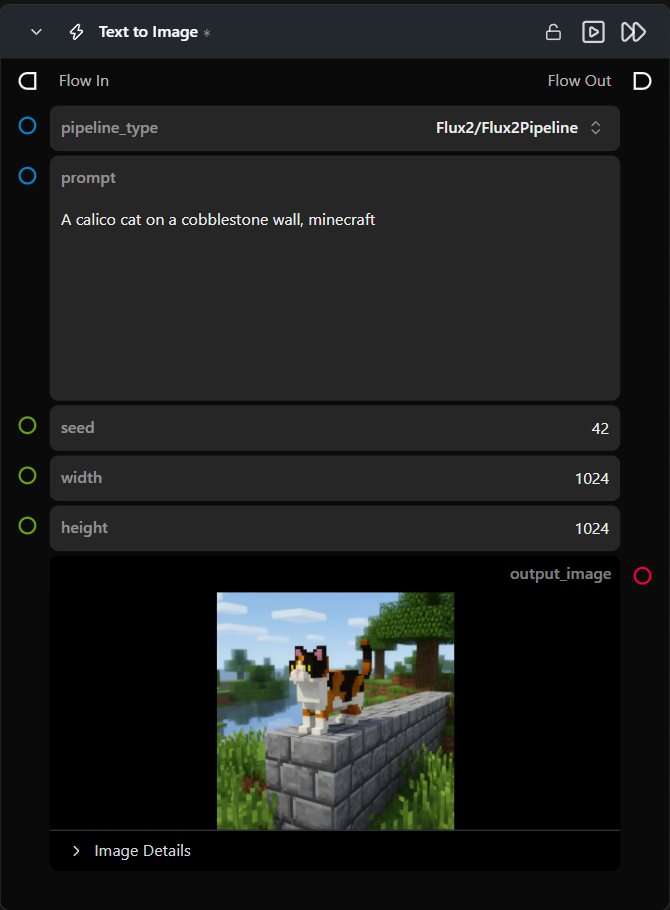

## When to use it

This node makes an image from a text description, called a prompt. It is a ready-made node that wraps a whole workflow, so you get one node instead of the full graph. The library marks it as a Labs node.

Use it to get an image fast. To see how the pieces connect, or to change the model or the steps, open the [Text2Image](../workflows/Text2Image.md) template.

The default `pipeline_type` here is `FluxPipeline`. The [Text2Image](../workflows/Text2Image.md) template uses Z-Image Turbo (`Tongyi-MAI/Z-Image-Turbo`) instead.

Inside, the node runs [Build Pipeline](../nodes/LatentDiffusionPipelineBuilderNode.md), [Create Noise Latent](../nodes/NoiseLatentNode.md), [Generate Latent](../nodes/DiffusionPipelineGenerateLatentNode.md) and [Decode Media](../nodes/VaeDecodeNode.md). It starts from noise as a [latent](../guides/what-is-a-latent.md), the compressed form of an image that the model works in, and decodes the result into a picture.

## What it needs

- A prompt.
- The model for the `pipeline_type` you pick, downloaded in advance in Model Manager. See [Hugging Face and Diffusers](../guides/hugging-face-and-diffusers.md). The default type, `FluxPipeline`, uses `black-forest-labs/FLUX.1-dev`.

## Where it fits

```text
[Text to Image] → Display Image
```



## Parameters

### pipeline_type

The model family to use. The default is `FluxPipeline`. The choices are `FluxPipeline`, `FluxKontextPipeline`, `Flux2Pipeline`, `Flux2KleinPipeline`, `QwenImagePipeline`, `StableDiffusionXLPipeline`, `StableDiffusion3Pipeline` and `ZImagePipeline`. Each choice picks its own model. See [How pipelines work](../guides/how-pipelines-work.md).

### prompt

The description of the image you want.

### seed

Default 42. The seed decides which noise the image starts from. The same seed and prompt give the same image.

### width

Image width in pixels. The default is 1024.

### height

Image height in pixels. The default is 1024.

### output_image

The finished image.
